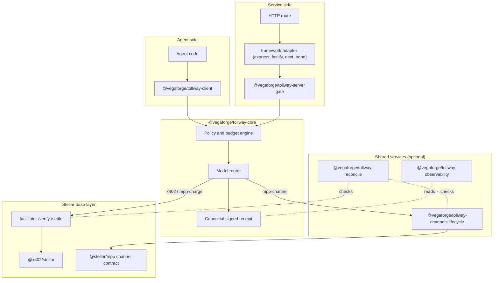
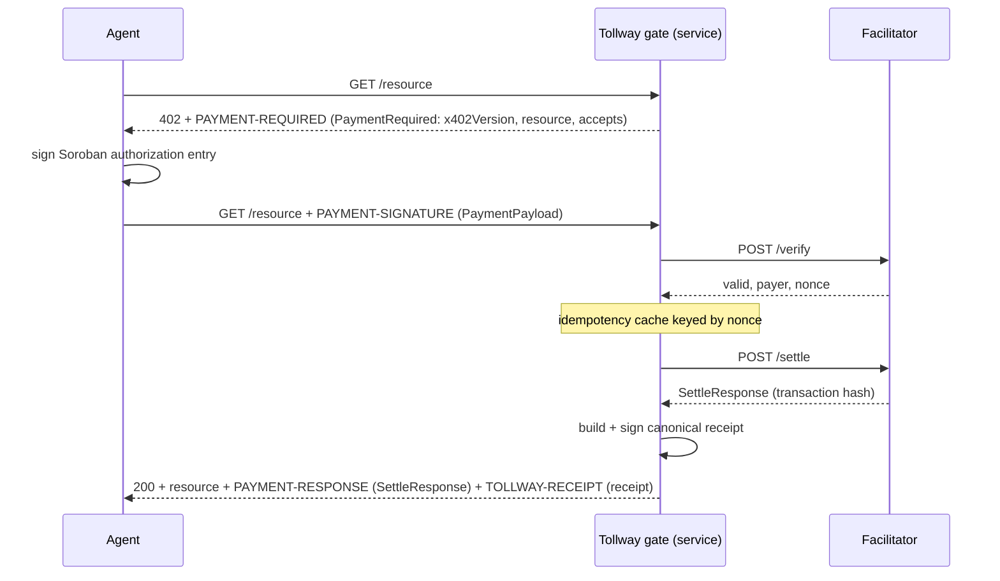

<p align="center">
  
</p>

<h1 align="center">Tollway</h1>

<p align="center">
  Orchestration, policy, and observability for agent payments on Stellar.
</p>

<p align="center">
  <a href="https://usetollway.netlify.app"><strong>Website</strong></a> ·
  <a href="https://usetollway.netlify.app/docs"><strong>Docs</strong></a>
</p>

<p align="center">
  <a href="https://github.com/vegaforge/tollway/actions/workflows/ci.yml"></a>
  <a href="LICENSE"></a>
</p>

---

## Why Tollway exists

Stellar ships two agent-payment primitives, and they are different tools with different settlement models and separate SDKs.

**x402** settles one payment per request. A client hits a route, gets a `402` carrying a `PAYMENT-REQUIRED` challenge, signs a Soroban authorization entry, resubmits it in a `PAYMENT-SIGNATURE` header, and a facilitator verifies and settles on chain before the server returns the resource. Funds go straight to the recipient; the facilitator is non-custodial.

**MPP** covers the other cost shapes. Its *charge* mode is per-request and on-chain, much like x402. Its *channel* mode is a different settlement model entirely: a one-way payment channel in a Soroban contract where the funder deposits once, then makes many off-chain payments by signing cumulative commitments, and a single on-chain transaction at close pays the recipient the cumulative total and returns the remainder.

Both primitives are good. The cost shows up the moment a service or an agent uses more than one of them. Someone has to choose the model per counterparty, run the channel lifecycle, enforce budgets across models, normalize three different settlement artifacts into one receipt, reconcile off-chain commitments against on-chain settlement, and provide observability over all of it. Every team rebuilds that layer, and it is real systems work.

Tollway is that layer, built once and shared. It sits **above** `@x402/stellar` and `@stellar/mpp` and composes them. It is not a facilitator, not a base SDK, and it never custodies funds.

## Architecture

Tollway is a library plus an optional shared service. Most users embed the library: a client wrapper on the agent side, payment-gate middleware on the service side. Teams that want shared budgets, reconciliation, and dashboards across many processes run the optional service.



### The model router

The router is the conceptual core. Per interaction or per counterparty it decides how a payment settles:

- **x402 per-request** is the default for unknown counterparties and the right answer when access is occasional and per-URL accountability matters.
- **MPP charge** applies when the service standardizes on MPP but traffic is still per-request.
- **MPP channel** kicks in when sustained high-frequency access to a single counterparty crosses a configurable threshold. The router opens a channel, routes later payments as off-chain commitments, and schedules the close.

Its inputs are declared offer hints, observed traffic shape, explicit configuration, and policy constraints. Every decision is overridable per route and per agent.

### The x402 request path

The x402 path runs end to end through `@vegaforge/tollway-core`, `@vegaforge/tollway-server`, an adapter, and a facilitator. The gate speaks the x402 V2 wire format (`@x402/core` 2.31): `PAYMENT-REQUIRED` carries standard base64 JSON of a `PaymentRequired`, `PAYMENT-SIGNATURE` carries a `PaymentPayload`, and `PAYMENT-RESPONSE` carries the facilitator's `SettleResponse`. The signed Tollway receipt travels beside it in `TOLLWAY-RECEIPT`. A stock x402 V2 client can pay a Tollway-gated route without changes ([#43](https://github.com/vegaforge/tollway/issues/43)).

For x402, `PaywallConfig.asset` is the Soroban asset contract address (`C...`, for example the USDC SAC), because that is what `PaymentRequirements.asset` names.



A short-lived settlement cache keyed by the authorization nonce makes a duplicate submission idempotent rather than a second charge. In channel mode the cumulative-commitment design is naturally idempotent, since a repeated commitment at the same sequence is a no-op.

### The canonical receipt

Every settlement, on any model, produces one signed receipt. Downstream accounting, dispute evidence, and analytics consume a single shape instead of three.

| Field | Meaning |
| ----- | ------- |
| `payer`, `payee` | Stellar addresses on each side |
| `amount`, `asset` | integer string in the asset's smallest unit |
| `resource` | URL or stable identifier of what was bought |
| `model` | `x402`, `mpp-charge`, or `mpp-channel` |
| `settlement` | transaction hash (x402, charge) or channel id + commitment sequence (channel) |
| `network`, `issuedAt` | testnet or mainnet, and an ISO 8601 timestamp |
| `signature` | Ed25519 over the canonical bytes, with the signing `keyId` |

Receipts are signed through a swappable signer interface, so the key can live in process, in a KMS, or behind an HSM. Canonicalization sorts object keys at every level, so the same receipt body always produces the same bytes and the same signature.

## Packages

Tollway is a pnpm and Turborepo monorepo. Each package is independently buildable, so you can work on one without building the rest.

| Package | Responsibility |
| ------- | -------------- |
| `@vegaforge/tollway-core` | model router, policy schema, canonical receipt, shared types |
| `@vegaforge/tollway-client` | agent-side client wrapper |
| `@vegaforge/tollway-server` | service-side payment gate, framework agnostic |
| `@vegaforge/tollway-adapter-express` | Express adapter (the reference adapter) |
| `@vegaforge/tollway-adapter-fastify` | Fastify adapter |
| `@vegaforge/tollway-adapter-next` | Next.js App Router adapter |
| `@vegaforge/tollway-adapter-hono` | Hono adapter |
| `@vegaforge/tollway-channels` | MPP channel lifecycle manager |
| `@vegaforge/tollway-reconcile` | reconciliation engine |
| `@vegaforge/tollway-observability` | metrics, exports, webhooks |
| `@vegaforge/tollway-theme` | shared design tokens |

Apps: `apps/web` (landing page and docs), `apps/dashboard` (observability UI), `apps/demo` (end-to-end x402 demo).

## Quickstart

Requires Node 22+ and pnpm 10+.

Scaffold a fresh paid API with Express, Hono, or Next.js:

```bash
npm create tollway -- --template express --dir my-api --yes
pnpm create tollway --template hono --dir my-api --yes
npm create tollway -- --template next --dir my-api --yes
```

Each generated project starts in mock mode, includes a testnet `.env.example`, and has a test that exercises its paid route. The mock signer creates no key and is only for local examples; bring a real signer before accepting real payments.

```bash
git clone https://github.com/vegaforge/tollway.git
cd tollway
pnpm install
pnpm build
pnpm test
```

Run the x402 demo with no network, from challenge to a verified receipt:

```bash
MOCK_MODE=true pnpm --filter @vegaforge/tollway-demo start
```

Without `MOCK_MODE`, the demo pays 0.001 testnet USDC through the OpenZeppelin Channels testnet facilitator and prints the settlement transaction hash. It needs two testnet accounts with a USDC trustline (the payer also needs testnet USDC from the [Circle faucet](https://faucet.circle.com/)) and an API key from [channels.openzeppelin.com/testnet/gen](https://channels.openzeppelin.com/testnet/gen). Use testnet keys only: the payer's secret key sits in an environment variable.

```bash
OZ_API_KEY=... \
STELLAR_RECIPIENT=G... \
STELLAR_SECRET_KEY=S... \
pnpm --filter @vegaforge/tollway-demo start
```

If a setting is missing or invalid, the demo lists every problem and exits with code 1. `FACILITATOR_URL` overrides the facilitator. `STELLAR_NETWORK=mainnet` switches to mainnet and then also needs `STELLAR_RPC_URL`.

The demo also runs named scenarios. With no argument it runs the x402 demo above:

```bash
MOCK_MODE=true pnpm --filter @vegaforge/tollway-demo start -- x402         # the default
MOCK_MODE=true pnpm --filter @vegaforge/tollway-demo start -- mpp-charge   # mock mode only
MOCK_MODE=true pnpm --filter @vegaforge/tollway-demo start -- all-models   # mock mode only
```

| Scenario | What it shows |
| --- | --- |
| `x402` | One per-request x402 payment producing a canonical receipt. Runs in mock or live mode. |
| `mpp-charge` | The same route with only the paywall's model switched to MPP charge: the same route serves both models with a config flag. |
| `all-models` | Runs `x402` then `mpp-charge` and prints one table. It exits non-zero if any receipt fails verification. CI runs it in mock mode on every commit. |

The MPP channel scenarios join once the gate accepts channel vouchers (#173).

Gate a route on the service side:

```ts
import { Ed25519Signer } from "@vegaforge/tollway-core";
import { createPaywall, createMockFacilitator } from "@vegaforge/tollway-server";
import { expressPaywall } from "@vegaforge/tollway-adapter-express";

const signer = await Ed25519Signer.generate("service-key");
const gate = createPaywall(
  { amount: "10000", asset: "USDC:GA5Z...", payTo: "GSERVICE...", network: "testnet" },
  { signer, facilitator: createMockFacilitator() },
);

app.get("/quotes/latest", expressPaywall(gate), (_req, res) => {
  res.json({ symbol: "XLM/USD", price: "0.1234" });
});
```

Pay a route from the agent side with x402 on Stellar. The secret goes only to `createEd25519Signer`; the settler never holds it. The settler speaks x402 V2 (`PAYMENT-REQUIRED`, `PAYMENT-SIGNATURE`) and reads the Tollway receipt from `TOLLWAY-RECEIPT`, the same wire format the gate speaks ([#43](https://github.com/vegaforge/tollway/issues/43)).

```ts
import { createClient, createX402Settler } from "@vegaforge/tollway-client";
import { Ed25519Verifier } from "@vegaforge/tollway-core";
import { createEd25519Signer } from "@x402/stellar";

const client = createClient({
  network: "testnet",
  settler: createX402Settler({
    signer: createEd25519Signer(process.env.STELLAR_SECRET_KEY ?? "", "stellar:testnet"),
    network: "testnet",
  }),
  verifier: new Ed25519Verifier({ "service-key": servicePublicKey }),
});

const { receipt } = await client.pay({ resource: "https://api.example.com/quotes/latest", offer });
```

### Concurrent payments

`pay()` is single-flight per purchase. Calls that are in flight at the same time for the same purchase share one settlement: one call signs and pays, and the others wait and resolve with the same receipt. An agent that fires the same request twice in parallel, as tool-calling models and retry loops do, pays once.

Two calls are the same purchase when they have the same `resource`, the same settlement model after routing, and the same `amount`, `asset`, `payTo` and `network` in the offer. Pass `idempotencyKey` to decide for yourself:

```ts
// Shared, although the resource strings differ. The first call's offer is the one paid.
await Promise.all([
  client.pay({ resource: url, offer, idempotencyKey: "order-42" }),
  client.pay({ resource: `${url}?retry=1`, offer, idempotencyKey: "order-42" }),
]);

// Never shared: two payments for the same offer.
await Promise.all([
  client.pay({ resource: url, offer, idempotencyKey: crypto.randomUUID() }),
  client.pay({ resource: url, offer, idempotencyKey: crypto.randomUUID() }),
]);
```

What each call sees:

- The result carries `deduplicated`: `false` for the call that paid, `true` for a call that waited.
- Only the call that paid checks the policy, records the spend and emits `payment`. A call that waited emits `payment:deduplicated` with the same receipt, so counting `payment` events counts payments.
- If the shared settlement fails, every call rejects with the same error, no spend is recorded, and one `error` event is emitted.

Known limits:

- Only calls that overlap are shared. Receipts are not cached, so a call made after the settlement finished is a new purchase and pays again.
- The in-flight table belongs to one `createClient()` instance in one process. Two workers of the same agent, or two clients in one process, do not see each other's payments and can both pay.

Pay an MPP charge route the same way with `createMppChargeSettler`. It reads the `WWW-Authenticate: Payment` challenge, refuses it unless the amount, recipient, token contract and network all match the offer the policy approved, signs the SEP-41 transfer with `@stellar/mpp`, and returns the receipt from `TOLLWAY-RECEIPT`. When the service also sends MPP's `Payment-Receipt`, its transaction hash must match the receipt's. The secret goes only to `@stellar/mpp`, and `globalThis.fetch` is never patched.

```ts
import { createClient, createMppChargeSettler } from "@vegaforge/tollway-client";
import { Ed25519Verifier } from "@vegaforge/tollway-core";

const client = createClient({
  network: "testnet",
  settler: createMppChargeSettler({
    secretKey: process.env.STELLAR_SECRET_KEY ?? "",
    network: "testnet",
    // "pull" (the default): the service submits the signed transaction and pays the fee.
    // "push": the agent submits it, so the agent's account also needs XLM for the fee.
    mode: "pull",
  }),
  verifier: new Ed25519Verifier({ "service-key": servicePublicKey }),
});

const { receipt } = await client.pay({
  resource: "https://api.example.com/quotes/latest",
  offer,
  model: "mpp-charge",
});
```

The offer's asset may be the token contract (`C...`), a classic `CODE:ISSUER` asset or `native`; the settler maps the last two to their Stellar Asset Contract on the offer's network.

For services with several priced endpoints, compile them in one route table and attach one adapter middleware:

```ts
import { createRouteTable } from "@vegaforge/tollway-server";
import { expressRouteTable } from "@vegaforge/tollway-adapter-express";

const routes = createRouteTable({
  "GET /quotes/:symbol": { amount: "10000", asset, payTo, network: "testnet" },
  "POST /inference": { amount: "50000", asset, payTo, network: "testnet" },
}, { signer, facilitator });
app.use(expressRouteTable(routes));
```

Fastify, Hono, and Next adapters expose `fastifyRouteTable`, `honoRouteTable`, and `withRouteTable`. See [the route tables guide](apps/web/src/content/docs/route-tables.mdx).

Next.js App Router services can either wrap a handler with `withPaywall`, or protect a route group in Next 16 `proxy.ts`:

```ts
// proxy.ts
import { paywallProxy } from "@vegaforge/tollway-adapter-next/proxy";
import { gate } from "./src/paywall.js";

export const proxy = paywallProxy({ routes: [{ path: "/api/paid", gate }] });
export const config = { matcher: ["/api/paid/:path*"] };
```

The proxy runs in Next 16's Node.js runtime. It removes caller-supplied receipt headers, then forwards the gate-produced receipt only to the downstream route. A route can read it with `getProxyReceipt(request)` from `@vegaforge/tollway-adapter-next/proxy`; the helper validates the signed-receipt schema. `PAYMENT-RESPONSE` and `TOLLWAY-RECEIPT` remain on the client response.

## Status

Tollway is pre-release. No package is published to npm yet; build from this repository.

Implemented and tested:

| Package or app | What works |
| -------------- | ---------- |
| `@vegaforge/tollway-core` | Canonical receipt (build, sign, verify) with a swappable Ed25519 signer, zod schemas, the policy engine (`createPolicyEngine`: budgets, per-service caps, rate limits, and anomaly stops, held in memory, with per-rule decision traces and a dry-run mode), and the default model router. |
| `@vegaforge/tollway-server` | The payment gate (`createPaywall`) for x402 and MPP charge, an HTTP facilitator client built on `@x402/core` and `@x402/stellar`, a mock facilitator, an MPP charge handler built on `mppx` and `@stellar/mpp` (plus a mock), and in-memory (bounded) and Redis settlement caches. |
| `@vegaforge/tollway-adapter-express`, `-fastify`, `-next`, `-hono` | All four adapters wrap the gate, each with its own tests. |
| `@vegaforge/tollway-client` | Agent-side orchestration: policy check, routing, receipt verification, and events, plus `createX402Settler`, a `ClientSettler` that pays x402 V2 routes on Stellar with `@x402/stellar`, and `createMppChargeSettler`, which pays MPP charge routes with `@stellar/mpp`. |
| `@vegaforge/tollway-channels` | Channel `open`, `commit`, `shouldClose`, and `close` against an injected `MppChannelAdapter`, and `createStellarMppChannelAdapter`, the adapter backed by `@stellar/mpp/channel`. |
| `@vegaforge/tollway-reconcile` | The reconciler and drift detection, with unit and property tests. |
| `@vegaforge/tollway-observability` | Metric recording, spend summaries, JSON and CSV export, and webhook delivery with retry and timeout. |
| `@vegaforge/tollway-theme` | Shared design tokens. |
| `apps/dashboard` | Agents, channels, and receipts views over typed hooks backed by stub data. |
| `apps/demo` | The x402 round trip in mock mode. |

Open work:

- `ChannelManager.recover`, which throws `NotImplementedError` today ([#38](https://github.com/vegaforge/tollway/issues/38)).
- Router promotion to `mpp-channel` under sustained traffic ([#105](https://github.com/vegaforge/tollway/issues/105)). The gate answers `501` if a router selects `mpp-channel`.
- x402 V2 wire compatibility for the gate's headers ([#43](https://github.com/vegaforge/tollway/issues/43)).
- Feeding gate outcomes into `@vegaforge/tollway-observability` ([#106](https://github.com/vegaforge/tollway/issues/106)) and signing webhook deliveries ([#104](https://github.com/vegaforge/tollway/issues/104)).
- A shared conformance suite for the four adapters ([#107](https://github.com/vegaforge/tollway/issues/107)).
- Dashboard services and exports views ([#108](https://github.com/vegaforge/tollway/issues/108), [#109](https://github.com/vegaforge/tollway/issues/109)). The overview and anomalies pages are placeholders.

Browse the [open issues](https://github.com/vegaforge/tollway/issues) for claimable work, especially the [good first issues](https://github.com/vegaforge/tollway/issues?q=is%3Aissue+is%3Aopen+label%3Adifficulty%3Agood-first-issue). The full design and the planned sequence of work are in [docs/design.md](docs/design.md).

## Security

Non-custodial throughout: x402 settles to the recipient, channel funds live in the channel contract, and Tollway never holds funds. Replay protection comes from the settlement cache and the idempotent cumulative-commitment design; reconciliation is the safety net against a counterparty that under-settles. Report vulnerabilities through [SECURITY.md](SECURITY.md), not public issues.

## Contributing

The monorepo is structured so you can own one package without learning the whole system. The framework adapters and the docs are the friendliest starting points; look for the `difficulty:good-first-issue` label. Start with [CONTRIBUTING.md](CONTRIBUTING.md).

## License

[Apache-2.0](LICENSE)
