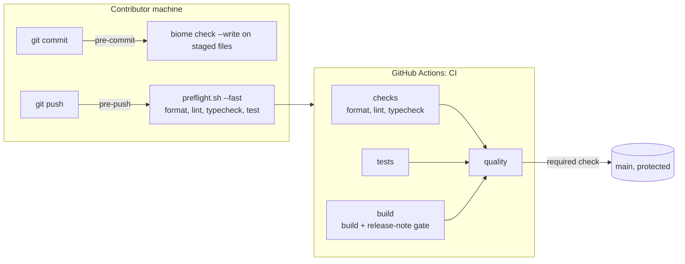

# ADR: Install AI-agent governance, local gates, and a split CI

- **Status:** Accepted 2026-10-29
- **Date:** 2026-10-29
- **Issue:** #114 (Wave issue form); supports #110 to #113, which already ask contributors to run `./scripts/preflight.sh`
- **Scope:** repository tooling, contributor docs, and CI. No package or app source changes.

## Context

- Tollway is opening to Wave contributors and to coding agents. Today the only
  written rules are in CONTRIBUTING.md and the pull request template, and
  nothing runs before CI.
- `main` is the only long-lived branch. Repository ruleset `main`
  (id 17385626, active) requires pull requests with one code-owner approval,
  squash merges only, linear history, and the status check `verify` with
  up-to-date branches. `verify` is the job name in today's `ci.yml`.
- CI (`.github/workflows/ci.yml`) is one `verify` job: lint, typecheck, test,
  build. It has no `permissions` block, which CodeQL reports as
  `actions/missing-workflow-permissions`. It uses `node-version: 22` while
  the repository has `.nvmrc`.
- `pnpm lint` is `biome check .`. Biome exits 0 when it finds only warnings,
  so warnings pass CI today. Verified: a file with an unused variable passes
  `biome check` and fails `biome check --error-on-warnings`.
- `.gitignore` ends with a bare `scripts` line, added in f7f5127 to keep the
  maintainer's `scripts/create-issues.sh` out of Git. No file under `scripts/`
  has ever been tracked. Any governance script added there would be ignored
  silently.
- No Git hooks exist (no husky, no lefthook, no `core.hooksPath`).
- pnpm 10 blocks dependency install scripts unless allowed. pnpm 10.26 and
  later read `allowBuilds` from `pnpm-workspace.yaml`.

## Decision

1. Add `AGENTS.md` as the single rulebook for agents and humans, `CLAUDE.md`
   containing only `@AGENTS.md`, and
   `.claude/skills/tollway-engineering-standards/SKILL.md` for the
   architecture table, correctness rules, and the payment-path defect
   checklist.
2. Add `scripts/preflight.sh` with five gates: `pnpm format:check`
   (`biome format .`), `pnpm lint`, `pnpm typecheck`, `pnpm test`,
   `pnpm build`. `--fast` skips the build.
3. Change `pnpm lint` to `biome check --error-on-warnings .` so warnings fail.
4. Add `scripts/check_release_notes.sh`: if `packages/*/src/` or
   `apps/*/src/` changed, a file under `docs/release-notes/` must change too.
   Warn locally, fail in CI (`STRICT_RELEASE_NOTES=true`).
5. Replace the bare `scripts` ignore with `/scripts/create-issues.sh`, and add
   `.worktrees/`, `/*.sh`, `.env*`, and `!.env.example`.
6. Add lefthook as a root devDependency, allowed to run its postinstall via
   `allowBuilds` in `pnpm-workspace.yaml`. `lefthook.yml` runs Biome with
   `--write` on staged files (fixes re-staged with `stage_fixed`) before a
   commit, and `./scripts/preflight.sh --fast` before a push.
7. Split CI into `checks`, `tests`, and `build` jobs plus an aggregate
   `quality` job that fails unless all three succeeded. Add top-level
   `permissions: contents: read`, `node-version-file: .nvmrc`, and
   `persist-credentials: false`, and pin each action to a commit SHA with the
   tag in a comment. `codeql.yml` and `release.yml` are unchanged.
8. Rename `.github/PULL_REQUEST_TEMPLATE.md` to
   `.github/pull_request_template.md` and extend it with a required
   `Closes #` line, release-note and changeset items, and the defect checklist.
9. Add `docs/adr/`, `docs/plans/`, and `docs/release-notes/` templates, and
   `docs/scenarios/` and `docs/archive/` placeholders.
10. Add `.github/ISSUE_TEMPLATE/wave_task.yml` with the Wave issue structure.
    `good_first_issue.yml`, `blank_issues_enabled`, and labels stay as they are
    here; #114 covers those.
11. The `verify` job goes away and `quality` replaces it as the one required
    check. There is no placeholder `verify` job. At merge time the maintainer
    edits ruleset 17385626 to require `quality` instead of `verify`. Until
    then this pull request cannot satisfy the ruleset, because nothing reports
    `verify` on it.

## Diagram

## Consequences

- Contributors get feedback in seconds at commit time and in about a minute at
  push time, instead of after CI.
- The ruleset needs one stable check name (`quality`), so CI jobs can be
  renamed later without touching settings. The switch from `verify` to
  `quality` is a one-time manual step, and any open pull request created
  before it will report `quality` but not `verify` until rebased.
- Every change to package or app source needs a release note, including docs
  pages under `apps/web/src/content/`. That is deliberate: the docs site is
  shipped content. If it proves noisy, narrow `APP_PATHS` in a follow-up.
- SHA pins mean Dependabot's github-actions updates change a SHA and a comment
  instead of a tag. The pins match the majors merged in #60 and #83
  (checkout v7.0.1, setup-node v7.1.0) and the existing pnpm/action-setup v6
  (v6.1.0).
- lefthook's postinstall writes hooks into the shared `.git/hooks`, so they
  apply to every worktree of a clone. In a worktree whose branch predates
  `lefthook.yml`, lefthook prints "No config files ... have been found" and
  exits 0, so older branches are not blocked.
- `pnpm install` in CI also runs lefthook's postinstall. It writes hook files
  in the runner's checkout and has no other effect.

## Alternatives considered

- **husky and lint-staged.** Two packages and a `prepare` script instead of
  one binary with a YAML file. lefthook runs Biome on staged files and
  re-stages fixes on its own.
- **Keep one CI job.** Simpler, but a single long job gives slower and less
  specific feedback, and branch protection would bind to a job name that the
  next change to CI may rename.
- **Shard tests.** The suite runs in seconds. Sharding through turbo splits
  every package's Vitest run rather than the suite, so it adds cost for no gain.
- **`lefthook install` in a `prepare` script.** Works, but pnpm would still
  warn that lefthook's build script was ignored. `allowBuilds` is the setting
  pnpm documents for this.

## Verification

- `./scripts/preflight.sh` passes on a clean checkout of this branch.
- `./scripts/preflight.sh --fast` passes and prints that the build was skipped.
- `bash scripts/check_release_notes.sh` passes on this branch, and in strict
  mode fails on a branch that changes `packages/*/src` without a release note.
- `pnpm exec lefthook run pre-commit` with a staged, badly formatted file
  rewrites and re-stages it.
- `actionlint .github/workflows/ci.yml` and `shellcheck scripts/*.sh` report
  nothing.
- On the pull request, CI shows `checks`, `tests`, `build`, and `quality`, all
  green.
