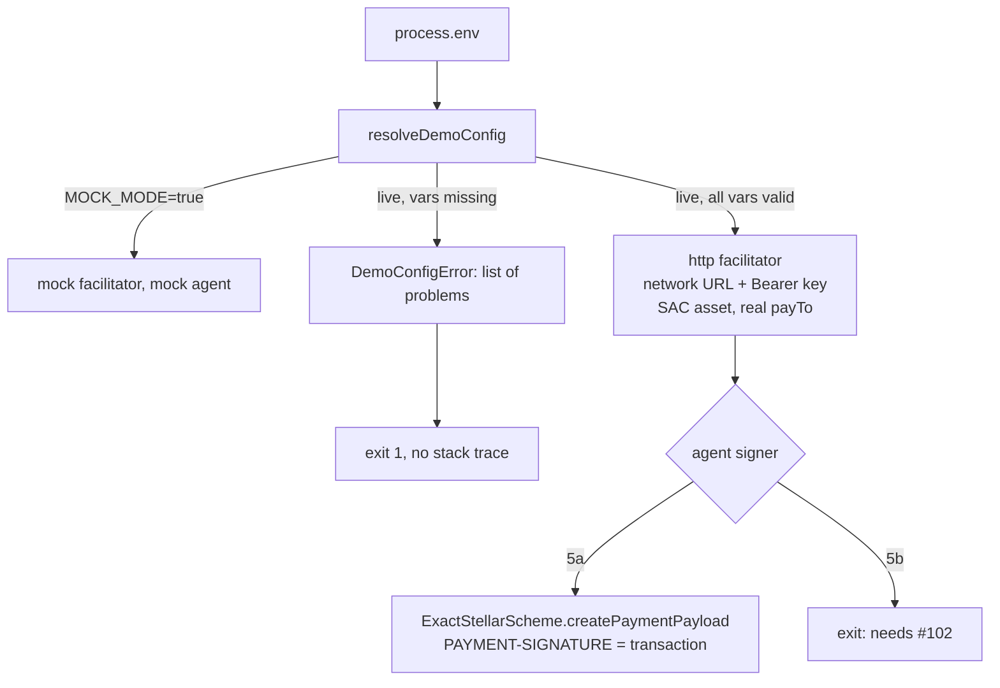

# ADR: Make the demo's live mode correct, or make it fail clearly

- **Status:** Accepted 2026-10-29
- **Date:** 2026-10-29
- **Issue:** #113 (code part; the docs part is on `docs/readme-accuracy`)
- **Scope:** `apps/demo/src/demo.ts`, `apps/demo/src/main.ts`,
  `apps/demo/src/demo.test.ts`, `packages/server/src/facilitator.integration.test.ts`,
  and the README quickstart snippet. No change to `@tollway/server` source.

## Context

Verified on `main` at `db70fae`:

- `apps/demo/src/demo.ts` defaults `FACILITATOR_URL` to
  `https://channels.openzeppelin.com/x402`, the mainnet facilitator, while the
  paywall config says `network: "testnet"`. The testnet facilitator is
  `https://channels.openzeppelin.com/x402/testnet`.
- OpenZeppelin Channels requires `Authorization: Bearer <key>` on testnet and
  mainnet. `createHttpFacilitator(url, { createAuthHeaders })` supports it;
  the demo never passes it. A live run gets a 401, which surfaces as a
  `TollwayError` stack trace from `/verify`.
- `asset` is `"USDC:GA5Z..."`, a classic asset code and issuer. x402 on
  Stellar expects the asset's Soroban contract address. The installed
  `@x402/stellar` 2.16.0 exports `USDC_TESTNET_ADDRESS`
  (`CBIELTK6YBZJU5UP2WWQEUCYKLPU6AUNZ2BQ4WWFEIE3USCIHMXQDAMA`).
- `payTo` is `GSERVICEXXXX...`, which is not a valid Stellar account id.
- `packages/server/src/facilitator.integration.test.ts` (opt-in, skipped by
  default) also defaults to the mainnet URL and sends no key.
- **Not in #113, but blocking:** in live mode the demo's "agent" still sends
  the literal string `mock-signed-auth-entry` as `PAYMENT-SIGNATURE`. Even
  with every default fixed, a real facilitator rejects it at `/verify`. No
  production signer ships yet (#102).
- The installed `@x402/stellar` 2.16.0 client exposes
  `new ExactStellarScheme(createEd25519Signer(secret, "stellar:testnet")).createPaymentPayload(2, requirements)`,
  which returns `{ payload: { transaction } }`. The gate's HTTP facilitator
  wraps the raw `PAYMENT-SIGNATURE` value as `payload.transaction`
  (`toPayload` in `facilitator.ts`), so a demo agent could send that
  `transaction` string directly, without waiting for x402 V2 header
  compatibility (#43).

## Decision

1. **Pure config resolution.** Add `resolveDemoConfig(env): DemoConfig` in
   `apps/demo/src/config.ts`. It reads `MOCK_MODE`, `STELLAR_NETWORK`
   (`testnet` default, `mainnet` allowed), `FACILITATOR_URL`, `OZ_API_KEY`,
   `STELLAR_RECIPIENT`, and `STELLAR_SECRET_KEY`, and returns either a mock
   config or a live config. It throws a `DemoConfigError` listing every
   missing or invalid variable at once.
2. **Network-derived defaults.** The facilitator URL defaults to
   `https://channels.openzeppelin.com/x402/testnet` for testnet and
   `https://channels.openzeppelin.com/x402` for mainnet. `FACILITATOR_URL`
   overrides it. The asset is `USDC_TESTNET_ADDRESS` or `USDC_PUBNET_ADDRESS`
   imported from `@x402/stellar` (added as a demo dependency at the version
   `@tollway/server` uses), not a hardcoded string.
3. **Auth.** Live mode requires `OZ_API_KEY` and passes
   `createAuthHeaders: async () => ({ verify: h, settle: h, supported: h })`
   with `h = { Authorization: "Bearer " + key }`.
4. **Recipient.** Live mode requires `STELLAR_RECIPIENT` and validates it as a
   `G...` account id with `StrKey.isValidEd25519PublicKey` from
   `@stellar/stellar-sdk` (already in the tree through `@x402/stellar`; add it
   as a direct demo dependency rather than relying on hoisting).
5. **Agent signing.** The maintainer chose **5a** on 2026-10-29. The options
   as proposed:
   - **5a (proposed).** Live mode requires `STELLAR_SECRET_KEY` and signs a
     real payment with `@x402/stellar`'s client `ExactStellarScheme`, built
     from the decoded `PAYMENT-REQUIRED` offer. The demo sends
     `payload.transaction` as `PAYMENT-SIGNATURE`. This makes "drop
     `MOCK_MODE`" work end to end on testnet today.
   - **5b.** Live mode exits with "live mode needs a payer signer; see #102"
     until #102 lands, and #113's live-run criterion moves to #102.
   Two details found in the installed `@x402/stellar` 2.16.0 client source
   while implementing 5a:
   - `createPaymentPayload` throws unless `requirements.extra.areFeesSponsored`
     is `true`. OpenZeppelin Channels sponsors fees, so live mode sets
     `extra: { areFeesSponsored: true }` on both the agent's requirements and
     the gate's `createHttpFacilitator` options, so the two sides send the
     same requirements.
   - `getRpcUrl` has a default for `stellar:testnet` only and throws for
     `stellar:pubnet` without one. `resolveDemoConfig` therefore also reads
     `STELLAR_RPC_URL`: optional on testnet, required on mainnet.
6. **Exit cleanly.** `main.ts` catches `DemoConfigError` and prints its list
   with exit code 1 and no stack trace. Other errors keep their stack.
7. **Integration test.** Defaults to the testnet URL and passes
   `OZ_API_KEY` through `createAuthHeaders`. It stays opt-in.
8. **Mock mode is unchanged** and needs no environment variables beyond
   `MOCK_MODE=true`.
9. The demo is private (`.changeset/config.json` ignores it), so no
   changeset. A release note is required.

## Diagram

## Consequences

- The README's live-mode sentence becomes true (with 5a) or honestly scoped
  (with 5b).
- With 5a, the demo depends on `@x402/stellar` and `@stellar/stellar-sdk`
  directly. They are already in the lockfile, so no new packages arrive.
- With 5a, the demo holds a payer secret key in an environment variable. The
  README must say to use a testnet key only.
- The config function is testable without a network, which is where the red
  tests live.

## Alternatives considered

- **Only fix the URL and key.** Satisfies part of #113 but leaves a live run
  that cannot succeed, which is the current problem in a different place.
- **Wait for #43 and use `@x402/fetch` on the agent side.** Cleanest end
  state, but blocks the demo on a larger wire-format change.

## Verification

Red tests first, in `apps/demo/src/config.test.ts` (new) and
`apps/demo/src/demo.test.ts`. Each must fail on `main` for the stated reason.

1. `defaults to the testnet facilitator for testnet`:
   `resolveDemoConfig({ OZ_API_KEY: "k", STELLAR_RECIPIENT: <valid G>, STELLAR_SECRET_KEY: <valid S> })`
   returns `facilitatorUrl === "https://channels.openzeppelin.com/x402/testnet"`.
   Fails today because the function does not exist and the hardcoded default
   is the mainnet URL. To keep the red honest, first write
   `runDemo calls the testnet facilitator in live mode` in `demo.test.ts`
   with `fetch` stubbed by `vi.stubGlobal`: it asserts the first facilitator
   request URL starts with `https://channels.openzeppelin.com/x402/testnet/`.
   That test fails today on the URL, not on a missing import.
2. `sends the API key on verify`: same stub, asserts
   `Authorization: Bearer k` on the `/verify` request. Fails today: no header.
3. `uses the USDC SAC address as the asset`: asserts the `PAYMENT-REQUIRED`
   challenge's `asset` equals `USDC_TESTNET_ADDRESS`. Fails today with
   `USDC:GA5Z...`.
4. `reports every missing variable in live mode`: empty env without
   `MOCK_MODE`; expects `DemoConfigError` naming `OZ_API_KEY`,
   `STELLAR_RECIPIENT` (and `STELLAR_SECRET_KEY` under 5a), and no `fetch`
   call. Fails today: it calls the network.
5. `rejects an invalid STELLAR_RECIPIENT`: `GSERVICEXXXX...` is rejected.
6. The existing mock-mode test stays unchanged and green.

Then: `./scripts/preflight.sh`, `MOCK_MODE=true pnpm --filter @tollway/demo start`,
`pnpm --filter @tollway/demo start` with no env (expect the clear message and
exit 1), and, under 5a with real testnet keys, one live run whose transaction
hash is checked on a testnet explorer and pasted in the pull request.
