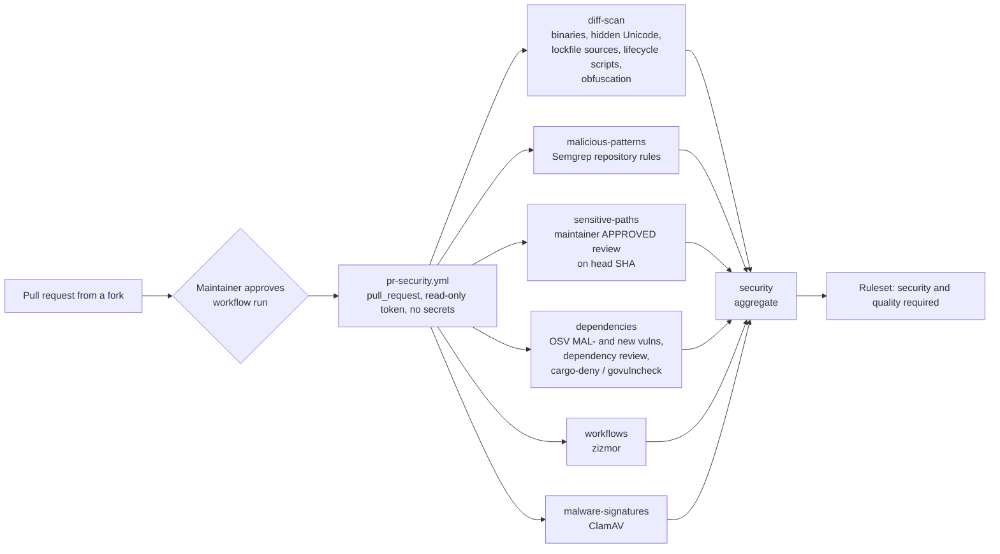

# ADR: A security gate that blocks malicious pull requests

- **Status:** Accepted 2026-10-30
- **Date:** 2026-10-29
- **Scope:** CI only: a new `.github/workflows/pr-security.yml`, scripts under `scripts/security/`, Semgrep rules under `.github/semgrep/`, CODEOWNERS entries, and repository settings. No application code changes. The same design ships to vegaforge/tollway, vegaforge/octroi and vegaforge/evergreen, with the per-repository differences listed under "This repository".

## Context

The org is applying to Drips Wave, which brings pull requests from many contributors the maintainers do not know. Maintainers in other Wave projects have had repositories removed after merging pull requests that carried malicious code aimed at the maintainer: code that runs on the maintainer's machine or in CI and steals tokens, SSH keys, npm or crates.io credentials, or wallet keys.

The ways a pull request can do that in these three repositories, checked against what each repository contains today:

1. **Install and build hooks.** A new or changed `preinstall`, `install`, `postinstall` or `prepare` script in any `package.json` runs on `pnpm install`. In Rust, a `build.rs` or a proc-macro runs at compile time. Octroi uses pnpm 9, which runs dependency install scripts by default. Tollway (pnpm 10) already blocks them unless they are listed under `allowBuilds`.
2. **Poisoned dependencies.** A new dependency that is a known malicious package, or a lockfile entry that resolves to a git URL, a tarball URL or a registry other than the official one.
3. **Developer tooling that executes code.** `lefthook.yml`, `scripts/`, `*.config.{js,mjs,ts}`, `.vscode/tasks.json`, `.devcontainer/`, `.cargo/config.toml` (runner, rustflags), `Makefile`, `Dockerfile`. These run on a maintainer's laptop during a normal review: checkout, install, commit, push.
4. **Workflow changes.** A changed `.github/workflows/*` file can read secrets or write to the repository once merged. Unsafe triggers (`pull_request_target`, `workflow_run`) and expression injection make this worse. None of the three repositories uses those triggers today.
5. **Hidden or obfuscated code.** Bidirectional or zero-width Unicode that makes code read differently than it runs ("Trojan Source"), long encoded blobs that are decoded and evaluated, string-built `require` and `eval`, and minified code committed outside build output.
6. **Binaries.** Executables, native addons, archives or other compiled files that reviewers cannot read.
7. **Known malware files.** Files that match published malware signatures.

What exists today: CodeQL in Tollway and Octroi (finds bugs, not malice), Dependabot, secret scanning with push protection, private vulnerability reporting, and, as of 2026-10-29, workflows from every outside contributor wait for maintainer approval before they run (`approval_policy: all_external_contributors`). Nothing blocks a pull request for the seven cases above.

No scanner catches all malicious code. This design layers cheap, deterministic checks that block the known patterns outright, and requires a maintainer's explicit review, recorded against the exact commit, for every change to a file that can execute code.

## Decision

1. **One workflow, `pr-security.yml`, on `pull_request` only.** Never `pull_request_target`. Top-level `permissions: {}`. Each job is granted `contents: read`, plus `pull-requests: read` for the job that reads reviews. The workflow is given no secrets. Every action is pinned to a full commit SHA. `actions/checkout` uses `persist-credentials: false`. **No job installs the pull request's dependencies or runs its code:** every check reads files and lockfiles statically. A final job named `security` aggregates the others and fails unless every one succeeded (the same pattern as `quality`).

2. **Job `diff-scan`: deterministic checks on the files the pull request changes** (`scripts/security/scan_diff.py`, Python standard library only, so it adds no dependency of its own). These fail the pull request, and there is no label override:
   - **Binaries:** an added or changed file is rejected if its content is an ELF, Mach-O, PE, WebAssembly, Java class or archive (zip, gzip, tar, 7z, rar) by magic bytes, or if it is non-text outside an allowlist of image and font types in documented asset folders. The allowlist lives in `.github/security/allowed-binaries.txt`, which is itself a sensitive path (item 4).
   - **Hidden Unicode:** any bidirectional control (U+202A to U+202E, U+2066 to U+2069), zero-width character (U+200B to U+200D, U+2060, U+FEFF outside a leading BOM) or Unicode tag character (U+E0000 to U+E007F) in an added line.
   - **Lockfile sources:** every `resolution` in `pnpm-lock.yaml` must come from `https://registry.npmjs.org/` (an integrity hash with no `tarball` or git URL). Every `source` in `Cargo.lock` must be `registry+https://github.com/rust-lang/crates.io-index` or the sparse crates.io index. `go.mod` must have no `replace` directive pointing at a path or URL, and `go.sum` must be consistent (checked with `go mod verify` in Octroi).
   - **New lifecycle scripts:** an added or changed `preinstall`, `install`, `postinstall`, `prepare`, `prepublish` or `prepack` in any `package.json` fails, unless the pull request author is an org owner or member. Contributors never need these.
   - **Obfuscation heuristics** on added lines in source files (not lockfiles, not snapshots): a line over 1,000 characters, a single string literal over 2,000 characters of base64 or hex, or a file where more than 10 percent of characters are `\x` or `\u` escapes. These patterns have no legitimate use in these codebases.

3. **Job `malicious-patterns`: Semgrep with rules the repositories own** (`.github/semgrep/`: `js.yaml`, `generic.yaml`, `go/gateway.yaml`, `rust/build.yaml`, `rust/proc-macro.yaml`), run with `semgrep scan --error --metrics=off` on the changed files only. It runs offline from the repository rules, so no code is sent anywhere. The rules target behaviour that steals or executes rather than ordinary bugs:
   - `eval`, `new Function`, `vm.runIn*Context` or `child_process.exec*/spawn*` whose argument comes from `Buffer.from(..., 'base64')`, `atob`, `String.fromCharCode`, a network response, or string concatenation.
   - Reads of credential locations (`.ssh/`, `.npmrc`, `.gitconfig`, `.config/gh`, `.cargo/credentials`, `.aws/`, browser profile and wallet paths, `id_rsa`, `id_ed25519`) anywhere in the codebase.
   - `process.env` (whole object, or keys matching `TOKEN|SECRET|KEY|PASS|SEED|MNEMONIC`) passed to `fetch`, `http(s).request`, `axios`, `net` or `dgram`.
   - Hard-coded exfiltration endpoints: Discord and Slack webhooks, Telegram bot API, pastebin-style hosts, ngrok, `*.oast.*`, interactsh, raw IP-address URLs.
   - Rust: `std::process::Command`, `std::net` or file reads under `$HOME` in `build.rs`, and network access from proc-macro crates.
   - Go: `os/exec` combined with a network fetch, and `init()` functions that make network calls.
   Every rule is ERROR severity and has matching and non-matching test cases in a sample file next to it (for example `js.ts` beside `js.yaml`), run with `semgrep --test` in the same job.

4. **Job `sensitive-paths`: changes that can run code need a maintainer's review on the exact commit.** If the pull request changes any of these paths:
   - `.github/**`, including workflows, CODEOWNERS and the security allowlists
   - `lefthook.yml`, `.husky/**`, `scripts/**`
   - `package.json` (any), `pnpm-lock.yaml`, `pnpm-workspace.yaml`, `.npmrc`
   - `Cargo.toml` (any), `Cargo.lock`, `build.rs` (any), `.cargo/**`, `rust-toolchain.toml`
   - `go.mod`, `go.sum`
   - `*.config.{js,cjs,mjs,ts,mts}`, `turbo.json`, `Dockerfile*`, `docker-compose*`, `Makefile`
   - `.vscode/**`, `.devcontainer/**`, `.idea/**`, `.envrc`
   
   then the job passes only if the GitHub reviews API shows an `APPROVED` review whose `commit_id` equals the pull request's current head SHA, from a user whose repository permission is `admin` or `maintain` (checked through `GET /repos/{owner}/{repo}/collaborators/{user}/permission`). Pushing a new commit invalidates the approval automatically, because the head SHA changes. The workflow also triggers on `pull_request_review: submitted`, so approving re-runs the gate. Exemptions: pull requests opened by an org owner or member, and by `dependabot[bot]` when it only touches manifests and lockfiles (Dependabot's changes still pass every other job). Everyone else, including outside collaborators with write access, goes through the review.

5. **Job `dependencies`: known-malicious and known-vulnerable dependencies.**
   - **OSV-Scanner** (`google/osv-scanner`, pinned release binary with its checksum verified) scans the head branch's lockfiles, then the base branch's. The job fails on any `MAL-` (malicious package) finding, and on any vulnerability that is in the head scan but not the base scan, so existing alerts do not block unrelated pull requests. It runs with `upload-sarif` off, because pull requests from forks cannot write security events.
   - **`actions/dependency-review-action`** with `fail-on-severity: moderate` and `deny-licenses` limited to licenses incompatible with Apache-2.0. It checks only dependencies the pull request adds or changes.
   - **Rust (Evergreen):** `cargo-deny check advisories sources bans` with a committed `deny.toml` that denies unknown registries and git sources. The RustSec database includes malicious crate notices.
   - **Go (Octroi):** `go mod verify` and `govulncheck ./...` in `apps/api-gateway`.

6. **Job `workflows`: zizmor on `.github/workflows/`** (pinned release, `--format=github`, `--min-severity=medium`), failing on dangerous triggers, expression injection, unpinned actions, excessive permissions and credential persistence.

7. **Job `malware-signatures`: ClamAV** (`clamscan` from the Ubuntu package, signatures refreshed with `freshclam`) over the changed files. Any detection fails the job.

8. **Enforcement.**
   - The aggregate `security` check becomes a required status check on `main`, next to `quality`.
   - CODEOWNERS assigns every sensitive path in item 4 to `@Signor1`, so a code-owner review is requested automatically.
   - Octroi gets the pnpm install-script allowlist it lacks (`pnpm.onlyBuiltDependencies` in the root `package.json`), so a malicious dependency's install script cannot run even after merge. Tollway already has `allowBuilds`.

9. **Maintainer and agent rule, added to `AGENTS.md`:** never check out and install a contributor's branch on a personal machine before `security` is green. When a local run is needed, use `pnpm install --ignore-scripts` (or `cargo check` in a throwaway container) and do not run the git hooks (`LEFTHOOK=0`). A contributor's branch can change `lefthook.yml` and the scripts the hooks call.

## Diagram

## Consequences

- A malicious pull request has to get past six independent checks and, for any file that can execute code, a maintainer's recorded approval of that exact commit.
- Contributors who touch build or tooling files wait for a maintainer review before the check goes green. That is intended: those files are exactly where an attack lives.
- Some false positives are possible from the heuristics and Semgrep rules. They are fixed by narrowing the rule, with a test case for the false positive, in a pull request that itself passes the sensitive-path review. There is no "skip security" label.
- The workflow adds about three to five minutes per pull request, mostly ClamAV's signature download.
- No check proves the absence of malice. This lowers the risk; it does not replace reading the diff.

## Alternatives considered

- **Hosted scanners (Socket, Snyk, StepSecurity Harden-Runner, Aikido).** Good malware detection for dependencies, but they need a GitHub App or an account and send code or metadata to a third party. They can be added later. The design here works with no external service.
- **Running the test suite in a sandbox and watching network calls.** It would catch more, but it means running untrusted code, and a sandbox that is reliable on GitHub-hosted runners is its own project.
- **A label such as `security-reviewed`.** Rejected: a label survives new commits, so an attacker could push after the label was applied. A review pinned to the commit SHA cannot be reused.
- **`pull_request_target` so the gate can comment on the pull request.** Rejected: it runs with a write token in the base repository's context and is the main way CI itself gets compromised.

## Changes made during implementation

The maintainer approved this record on 2026-10-30 and asked for two additions while it was being built. Building it also turned up gaps in the original design. Each change below makes the gate stricter. None of them relaxes it.

1. **The checks run from the base branch.** A `pull_request` workflow runs the workflow file from the pull request itself. So the scripts, Semgrep rules and allowlists are checked out from the base commit, and the pull request is read only as data. A pull request that edits a check therefore cannot weaken its own scan. The workflow file is still the pull request's copy. That is why `.github/**` is a sensitive path, why CODEOWNERS covers it, and why fork workflows wait for a maintainer's "Approve and run". The first install, when the base branch has no checks yet, falls back to the pull request's copies and prints a warning.
2. **Scanner errors fail the run.** In testing, a file padded to 700 KB made Semgrep time out and report no findings. Every Semgrep error (timeout, parse failure, out of memory) now fails `malicious-patterns`, and `diff-scan` rejects source files over 512 KB.
3. **SVG content (maintainer request).** `diff-scan` rejects SVGs that contain scripts, event-handler attributes, `javascript:` URLs, `<foreignObject>` or other embedded HTML, XML entities, external stylesheets, or `href`/`src`/`url()` references to external URLs or `data:` URIs. All six SVGs in the three repositories pass.
4. **Symlinks and submodules.** `diff-scan` rejects new symlinks, which can point a tool at files outside the repository, and new Git submodules.
5. **Knip (maintainer request).** Knip finds dependencies that nothing imports, imports that nothing declares, and unresolved imports. Knip loads the project's config files to work, which means it runs pull request code. So it runs in the existing `quality` CI and in `./scripts/preflight.sh`, which already run pull request code without secrets, and not in the read-only `security` jobs. Packages it found unused were removed: `@tollway/observability` from the Tollway dashboard, and `@stellar/stellar-base`, `@tremor/react`, `shiki` and `sonner` from the Octroi dashboard. Octroi also lost a duplicate root `tsx`. Knip config files are sensitive paths.
6. **Rust advisories go through OSV-Scanner.** The Evergreen dependency tree already carries RUSTSEC-2026-0387 (`crypto-bigint`) and a yanked `spin`, both through `soroban-sdk`. A `cargo-deny check advisories` would block every pull request. `cargo-deny` checks `bans` and `sources` instead. OSV-Scanner, which includes the RustSec database and compares against the base branch, covers advisories.
7. **Existing workflows fixed to pass zizmor.** In Tollway, `codeql.yml` and `release.yml` now pin every action to a commit SHA, and `release.yml` grants write permissions only to the Changesets job. That job keeps its checkout credentials because it pushes the version branch, and the exception is commented. In Evergreen, every checkout sets `persist-credentials: false`.
8. **Exact tools.** Semgrep 1.181.0 and zizmor 1.31.1 install from `.github/security/requirements.txt` with every hash pinned. OSV-Scanner 2.7.0 and cargo-deny 0.20.2 are verified against their release checksums. govulncheck is v1.7.0, the newest that builds with the gateway's Go 1.25. Each release is at least two weeks old.
9. **Install-script allowlist for Octroi:** `esbuild`, `lefthook` and `sharp`, the only three dependencies with install scripts today.
10. **Licence policy.** `dependency-review-action` denies AGPL, GPL, SSPL and BUSL licences on new dependencies.

11. **Two narrow, documented exceptions.** `.github/security/osv-scanner.toml` ignores five moderate advisories in `mcp` 1.29.0 and `opentelemetry-api` 1.37.0. These are Python dependencies of Semgrep itself, which every Semgrep release up to 1.183.0 pins. The gate never runs an MCP client or server and never parses trace headers. Each entry expires on 2027-01-31. The language-independent Semgrep rules skip `scripts/security/`, because the checks there name credential paths and exfiltration hosts in order to detect them. Both files are sensitive paths.

**Open item:** required code-owner review on `main` in Evergreen and Octroi. Tollway already has it. GitHub would then itself require the maintainer's approval for any change to `.github/**`, whatever the workflow file says. The maintainer would merge their own pull requests with the admin bypass, as in Tollway today. This is a settings change, so it waits for the maintainer's decision.

## Verification

- For each repository, a test branch with one deliberate sample per check, each harmless: an ELF header file, a bidi control character, a lockfile entry with a git URL, a new `postinstall`, a `build.rs` that reads `$HOME/.ssh`, a base64 string passed to `eval`, a workflow using `pull_request_target`, the EICAR antivirus test string, and a known `MAL-` package pinned in a scratch lockfile. Each must fail its job with a clear message. The branch is never merged, and the pull request shows the red runs.
- Semgrep rule tests pass (`semgrep --test .github/semgrep`): 14 rule groups, each with matching and non-matching samples.
- The scanner's own tests pass (`python3 -m unittest discover -s scripts/security`): 59 tests. Turning off any single detector fails at least one of them.
- An audit of every file already in the three repositories (`scan_diff.py --all`) finds nothing.
- A clean pull request passes `security` in under five minutes.
- A sensitive-path change by a non-member stays red until a maintainer approves the head commit, and turns red again after a new push.
- The ruleset lists `security` and `quality` as required.

## This repository

| | Tollway | Octroi | Evergreen |
|---|---|---|---|
| Lockfiles | `pnpm-lock.yaml` | `pnpm-lock.yaml`, `apps/api-gateway/go.sum` | `Cargo.lock`, `bindings/evergreen-js/package-lock.json` |
| Language rules | TS/JS | TS/JS, Go | Rust, TS |
| Extra dependency check | none | `go mod verify`, `govulncheck` | `cargo-deny` with `deny.toml` |
| Install-script allowlist | exists (`allowBuilds`) | add `pnpm.onlyBuiltDependencies` | npm binding: `ignore-scripts=true` in `bindings/evergreen-js/.npmrc` |
| Collaborators with write access who are not org members | none | AbelOsaretin (admin role): PRs go through the sensitive-path review unless made an org member | none |
