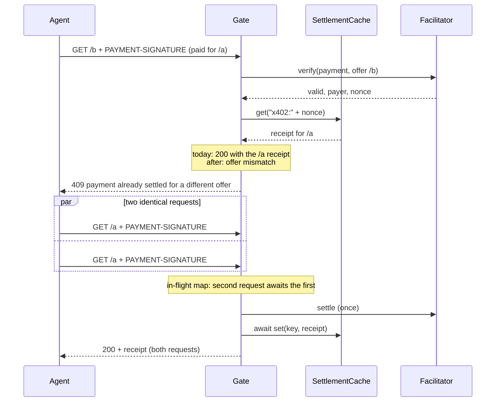

<!--
  EMBARGOED SECURITY RECORD. DO NOT PUSH THIS BRANCH OR OPEN A PUBLIC PULL REQUEST.
  This file describes an unfixed vulnerability in @tollway/server. It lives only
  in the maintainer's local worktree (.worktrees/fix-settlement-cache-binding)
  until the fix is developed in a GitHub security advisory private fork and the
  advisory is published. See "Disclosure plan" below.
-->

# ADR: Bind cached receipts to the offer, deduplicate in-flight settlements, and await cache writes

- **Status:** Accepted 2026-10-29. **Embargoed: keep local.**
- **Date:** 2026-10-29
- **Issue:** none filed on purpose. Tracked as a private GitHub security advisory (to be drafted).
- **Scope:** `packages/server/src/gate.ts`, `packages/server/src/cache.ts`, their tests, and one adapter-level test. No change to `@tollway/core`, the receipt format, or the adapters' source.

## Context

### The defects

`settleWithHandler` in `packages/server/src/gate.ts` (origin/main `a095452`)
runs in this order:

1. `handler.verify({ payment, offer })` returns `{ payer, nonce }`.
2. `cache.get(nonce)`. On a hit, the cached receipt is returned as
   `{ kind: "settled", status: 200, replayed: true }`. Nothing compares the
   cached receipt with the offer being served.
3. `handler.settle(...)`, then `signReceipt(buildReceipt(...))`.
4. `cache?.set(verification.nonce, receipt);` with no `await` (line 140).

That gives three defects:

- **D1, replay across offers (security).** The cache key is the nonce alone.
  A payment settled for route A is accepted on any route B that shares the
  cache, for the length of the TTL (30 seconds by default). The adapter lets
  the request through because the outcome is `settled`. The receipt returned
  still says route A, so the payer of A gets B for free, and the service has
  no record of a sale for B.
- **D2, concurrent duplicate settlement.** Two identical requests in flight
  both miss the cache and both call `settle`. The cache exists because
  facilitators are vulnerable to duplicate `/settle` submissions
  (`cache.ts` header comment, `docs/design.md` "Design notes"), and this is
  that case.
- **D3, floating cache write.** When `set` rejects (for example a Redis
  outage with `createRedisSettlementCache`), the rejection is unhandled. Node
  terminates the process on an unhandled rejection by default, after the
  gate has already answered 200.

### Verified on origin/main

A throwaway Vitest file (not committed) against `a095452`, using
`createMockFacilitator`, `createInMemorySettlementCache`, and three gates
sharing one cache, all assertions passed:

| Probe | Observed |
| ----- | -------- |
| Settle on `/a` (amount `10000`), replay the same `PAYMENT-SIGNATURE` on `/b` (amount `10000`) | `settled`, `replayed: true`, `receipt.resource === "/a"` |
| Same replay on `/c` with amount `99999999` | `settled`, `replayed: true`, `receipt.amount === "10000"` |
| Two concurrent identical requests via `Promise.all` | `settle` called 2 times |
| Cache whose `set` rejects | outcome `settled`; one `unhandledRejection` with `Error: redis down` |

So with a handler that does not itself reject a reused payment, D1 is not
limited to same-price routes: any route behind the same cache is open.

### What limits exposure today

- **Which handlers are affected.** The mock facilitator and the mock MPP
  charge handler accept any non-empty payment, so D1 is fully exploitable
  with them. The demo and every example ship with the mock. With
  `createHttpFacilitator`, step 1 sends the offer's `amount`, `asset`, and
  `payTo` to `/verify`, so a cross-price replay should fail there, and a
  facilitator that simulates the transaction should reject an authorization
  entry whose nonce is already consumed. This is **unverified against a live
  facilitator** (no API key was used). Cross-resource replay at the same
  price and payee is not caught by `/verify` in principle, because x402
  `PaymentRequirements` as built in `toRequirements` carries no resource.
- **Who runs this code.** Every workspace package is at version `0.0.1` and
  none has been published from this repository. The `@tollway/server` and
  `@tollway/client` packages on npm (versions 0.1.0 to 0.2.0, March 2026) are
  published by a different maintainer from `TollwayProtocol/Tollway` and
  contain unrelated code (`npm view @tollway/server repository maintainers`).
  Exposure is limited to people running this repository from source or
  copying the gate.

### A related ordering problem

Because `verify` runs before the cache lookup, a legitimate retry of a payment
that already settled is sent to `/verify` again. A real facilitator is likely
to reject it as spent, so the payer gets a 402 instead of the cached receipt.
If that holds, the cache gives no idempotency with a real facilitator and only
replay surface with a mock. This is also unverified live and is listed as an
open question below rather than decided here.

## Decision

1. **Bind every cache entry to its offer.** The gate derives an offer key
   from `model`, `network`, `resource`, `amount`, `asset`, and `payTo`, using
   `canonicalJson` from `@tollway/core` so it is stable. The cache key becomes
   `<model>:<nonce>`. On a hit, the gate compares the cached receipt's
   `resource`, `amount`, `asset`, `payee`, `network`, and `model` with the
   current offer. Equal: return it as today (`replayed: true`). Not equal:
   return `{ kind: "rejected", status: 409, reason: "payment already settled for a different offer" }`
   and never call `settle`.
2. **Deduplicate in-flight settlements.** Add an in-process map from cache key
   to the pending settlement promise inside `createPaywall`. A second request
   with the same key awaits the first and then goes through the binding check
   in item 1. For multi-process deployments, extend `SettlementCache` with an
   optional `acquire(key, ttlMs): Promise<boolean>` and `release(key)`.
   `createRedisSettlementCache` implements `acquire` with
   `SET key value NX PX ttl`. When `acquire` returns false, the gate answers
   `{ kind: "rejected", status: 409, reason: "settlement in progress" }`, and
   the client retries. `RedisLikeClient` gains the `NX`/`PX` overload of `set`.
3. **Await the cache write and surface its failure.** `await cache.set(...)`.
   If it rejects, the settlement has already happened, so the gate still
   returns the signed receipt, and the outcome carries the error in a new
   optional field `cacheError: Error` on the `settled` variant. A new optional
   `onCacheError(error, key)` in `PaywallDeps` is called as well. Nothing is
   swallowed: the caller sees the error on the outcome, and an unhandled
   rejection can no longer occur.
4. **Ship as one patch.** One changeset for `@tollway/server` (patch), one
   release note, and these ADRs flipped to Accepted in the same change.

Decided at approval (2026-10-29), taking the conservative option for both
open questions:

- **Cache lookup stays after `verify`.** This change does not move it, so
  behaviour for a retry after a real settlement is the same as before. Moving
  the lookup ahead of `verify` still needs one live run against the
  OpenZeppelin testnet facilitator to see how `/verify` treats a spent
  authorization entry, and is left for a follow-up.
- **`409` is the status for D1 and D2**, with the reasons given in items 1
  and 2.

## Diagram

## Consequences

- A payment unlocks exactly the offer it paid for. Retries of the same offer
  behave as today.
- The `SettlementCache` interface grows two optional methods. Custom caches
  that do not implement them still work, but only get in-process
  deduplication; the docs must say so.
- `GateOutcome` gains an optional field. This is additive, but adapters that
  log outcomes should log `cacheError`. Adapter source is unchanged in this
  fix; the conformance suite (#107) should assert it later.
- The cache key format changes (`<model>:<nonce>`). Entries written by an
  older gate in a shared Redis are ignored for at most one TTL after deploy,
  which is the safe direction.
- #103 (bounded in-memory cache) touches the same file. Land this first, or
  ask the #103 assignee to rebase; the in-flight map stays separate from the
  stored entries, as #103 already anticipates.

## Alternatives considered

- **Put the resource into the nonce.** Fixes D1 for the cache key, but hides
  the binding inside a hash, so a mismatch looks like a miss and the gate
  would call `settle` again with a spent payment. An explicit comparison
  gives a clear rejection.
- **Fire and forget the write with `.catch(log)`.** Removes the crash but
  hides the failure, which Directive 4 forbids.
- **Fail the request when the cache write fails.** The payment has already
  settled on chain. Withholding the receipt would charge the agent and give
  nothing back.
- **Redis lock only, no in-process map.** Needs Redis even for a single
  process and does not help the default in-memory setup.

## Verification

Red tests to write first. Each must fail on `a095452` for the stated reason
before any production change.

In `packages/server/src/gate.test.ts`:

1. `rejects a payment settled for one resource when replayed on another`:
   two gates, one shared in-memory cache, same `PAYMENT-SIGNATURE`, resources
   `/a` and `/b`, same price. Expect the second outcome to be `rejected` with
   status 409. Fails today because it is `settled` with `replayed: true`.
2. `rejects a replay on an offer with a different amount`: as above with a
   different `amount`. Fails today for the same reason.
3. `does not serve an x402 receipt to an mpp-charge offer that shares the
   cache` (proposed as `rejects a replay across models`): an x402 gate and an
   mpp-charge gate sharing one cache, same header value. The nonces collide
   today: both mock handlers use `mockHex(header, 32)`, and the real
   `deriveNonce` and `deriveMppChargeNonce` are both SHA-256 of the raw header
   in base64url. Fails today because the mpp-charge gate returns the x402
   receipt. With the `<model>:<nonce>` key the two entries no longer collide,
   so the mock MPP handler settles the payment as its own; the test asserts a
   fresh `mpp-charge` receipt rather than a 409, since the binding check is
   never reached. A real MPP handler would reject an x402 payload at
   `verify`.
4. `settles concurrent identical payments once`: a facilitator wrapper that
   counts `settle` calls and delays 20 ms; `Promise.all` of two requests.
   Expect one call and two `settled` outcomes with the same receipt. Fails
   today with two calls.
5. `does not leave a cache write rejection unhandled`: a cache whose `set`
   rejects; listen for `unhandledRejection`. Expect none, an outcome of
   `settled`, and `cacheError` set. Fails today with one unhandled rejection.
6. Keep the existing `treats a repeated payment as idempotent` test green
   unchanged: same offer, same payment, second outcome `replayed: true`.

In `packages/server/src/cache.test.ts`:

7. `acquire is exclusive across two Redis caches on one client`: two
   `createRedisSettlementCache` instances over one `ioredis-mock` client; the
   first `acquire` returns true, the second false until `release`.

In `packages/adapter-express/src/adapter.test.ts`:

8. `does not serve a second route for a payment made on the first`: an Express
   app with two paid routes on one gate cache; the replay on the second route
   gets 409 and the handler does not run.

Then: `./scripts/preflight.sh` (or the four commands until governance lands),
`MOCK_MODE=true pnpm --filter @tollway/demo start`, and, if a key is
available, one live testnet run to answer the open question.

## Disclosure plan

1. **Draft a private advisory now.** On GitHub: Security, Advisories, "New
   draft security advisory" for `vegaforge/tollway`. Affected package
   `@tollway/server`, ecosystem npm, affected versions `<= 0.0.1` (source on
   `main` through `a095452`; never published from this repository). Severity
   to be set by the maintainer; suggested Medium, because exploitation needs
   a handler that accepts a reused payment, which the shipped mocks do.
2. **Develop the fix in the advisory's temporary private fork**, not by
   pushing this branch. Move these ADRs and the red tests there.
3. **Version.** Add a `@tollway/server` patch changeset. That bumps this
   repository's `0.0.1` to `0.0.2`. A `0.2.1` release is not possible from
   here: npm versions 0.1.0 to 0.2.0 of `@tollway/server` belong to another
   publisher, and this repository cannot publish under the `@tollway` scope
   until the maintainer secures the scope or renames the packages. That is a
   separate decision, and it blocks every release, not only this fix.
4. **Merge** the private fork into `main` from the advisory page.
5. **Publish the advisory** once `main` has the fix (and, if a scope is
   secured by then, once the patched version is on npm). Request a CVE from
   GitHub if the maintainer wants one. Credit the reporter if external.
6. **After publication**, update `README.md`'s Security paragraph, which
   today says replay protection comes from the settlement cache, and file a
   public issue for the open ordering question.
