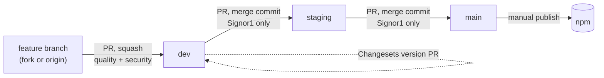

# ADR: Three long-lived branches, dev to staging to main

- **Status:** Accepted 2026-11-18
- **Date:** 2026-11-18
- **Issue:** none (maintainer request)
- **Scope:** repository settings (branches, rulesets, branch protection,
  merge methods, default branch), `.github/workflows/ci.yml`,
  `.github/workflows/codeql.yml`, `.github/workflows/release.yml`,
  `.github/dependabot.yml`, `.github/pull_request_template.md`, `AGENTS.md`,
  `CONTRIBUTING.md`. No package or app source changes.

## Context

Today `main` is the only long-lived branch (AGENTS.md, Directive 1). Every
pull request targets it, and ruleset 17385626 protects it: squash only, linear
history, one approving review with code owner review, `quality` and `security`
required and strict. The ruleset's bypass list holds the repository admin role
in `always` mode, so an admin can merge with `gh pr merge --admin` while checks
are red or reviews are missing.

Two people hold the admin role: `Signor1` and `AbelOsaretin`. Both are
organization owners (`gh api orgs/vegaforge/memberships/<login>` returns
`role: admin`).

The maintainer wants the flow used in another of their repositories: a
`dev` branch for development, `staging` for testing and `main` for
production. Contributors open pull requests into `dev` only. `staging`
accepts pull requests from `dev` only, and `main` accepts them from
`staging` only. Only the maintainer (`Signor1`) merges into any of the three,
and only when every check is green.

Wave contributors (Drips) will be opening many pull requests at once, so the
rules have to be enforced by GitHub, not by convention.

Two things in the current setup conflict with the new flow:

1. `release.yml` runs Changesets on every push to `main`, which opens a
   "Version Packages" pull request from `changeset-release/main` into
   `main`. Under the new flow that pull request could never merge. (It also
   fails today because the repository does not let Actions open pull
   requests.)
2. Promotions need merge commits. If `dev` were squash-merged into
   `staging`, the two branches would stop sharing history and every later
   promotion would conflict.

## Decision

1. Create `dev` and `staging` from the current `main`. Make `dev` the
   default branch, so forks and new pull requests target it, and so
   `Closes #N` closes the issue when a contributor's work lands in `dev`.
2. Add a `branch flow` job to `ci.yml` and make `quality` depend on it.
   For a pull request it fails when:
   - the base is `main` and the head is not `staging`;
   - the base is `staging` and the head is not `dev`;
   - the base is `dev` and the head is `staging` or `main`;
   - the base is `staging` or `main` and the head comes from a fork.

   It passes on pushes. Because `quality` is already required, the flow is
   enforced without adding a new required check.
3. Run CI and CodeQL on pushes and pull requests for all three branches.
4. Replace ruleset 17385626 with two rulesets that have **no bypass
   actors**, so nobody, the owner included, can merge with red checks:
   - `dev`: no deletion, no force push, pull request required, squash
     only, conversations resolved, `quality` and `security` required with
     the strict "up to date" policy.
   - `staging` and `main`: no deletion, no force push, pull request
     required, merge commit only, conversations resolved, `quality` and
     `security` required, not strict. (Strict would demand that `dev`
     contain the merge commits of `staging`, which the flow forbids.)

   Required approvals drop to 0 in both. Only one person can merge, so the
   merge is the review. The `sensitive paths` job inside `security` still
   demands a maintainer's approval on the exact commit for contributor
   changes to sensitive files, as today.
5. Restrict who can merge with classic branch protection on all three
   branches: push restrictions limited to `Signor1`, with "do not allow
   bypassing" on, so the restriction also binds organization owners.
   Rulesets cannot name a single user as the only allowed actor, which is
   why this one setting stays in classic protection.
6. Allow merge commits in the repository settings (squash stays on). The
   rulesets decide which method each branch accepts.
7. Versioning moves to `dev`: `release.yml` runs Changesets on pushes to
   `dev`, so the "Version Packages" pull request targets `dev` and flows up
   with everything else. Publishing stays manual: the `workflow_dispatch`
   publish job runs on `main` only, and refuses to run if unreleased
   changesets are still present. For the version pull request to open, the
   setting "Allow GitHub Actions to create and approve pull requests" must
   be on (it already blocks the current workflow).
8. Dependabot targets `dev` (`target-branch: dev`) for both ecosystems.
9. Update AGENTS.md (Directive 1, Lifecycle steps 0, 3 and 7, Git and pull
   requests), CONTRIBUTING.md and the pull request template to describe the
   flow: branch from `origin/dev`, open the pull request into `dev`, never
   aim a fix at `staging` or `main`.

### Amendment, 2026-11-18

At the maintainer's request, decision 7 runs by hand while nothing is being
published. The Release workflow no longer runs on pushes to `dev`; the
maintainer starts it on `dev` with "version" set when a release is being
prepared, and on `main` with "publish" set to publish. Every other decision
is unchanged.

## Diagram

## Consequences

- Nobody can merge with failing checks, including the owner. A broken
  required check now blocks everything until it is fixed in a pull request.
  This is the intended trade-off.
- `AbelOsaretin` keeps the admin role and could change these settings, but
  can no longer merge. Removing that ability entirely would mean changing
  their org role, which is outside this decision.
- Urgent fixes go through `dev` and two promotions. There is no hotfix
  shortcut.
- Netlify keeps deploying production from `main`. A staging site needs a
  branch deploy for `staging` turned on in the Netlify UI; that is a
  separate, optional step.
- Open pull requests against `main` (Dependabot and contributor ones) must
  be retargeted to `dev` or recreated. Dependabot recreates its own after
  the config change.

## Alternatives considered

- **Keep one branch and ask people to behave.** Rejected: the request is for
  enforced environments, and a Wave brings many new contributors.
- **Ruleset `update` restriction with a bypass actor.** Rulesets accept
  roles, teams and apps as bypass actors, not individual users, and both
  people share the admin role. A bypass would also let the holder skip the
  required checks in that ruleset.
- **Keep versioning on `main` and allow `changeset-release/main` into
  `main`.** Rejected: it adds an exception to the one rule that must have
  none, and `dev` would then lack the version commits.
- **Squash promotions.** Rejected: branches stop sharing history and every
  promotion conflicts.

## Verification

1. After merge and settings, open throwaway pull requests and confirm:
   feature into `staging` fails `branch flow`; feature into `main` fails;
   `staging` into `dev` fails; feature into `dev` passes.
2. Confirm a pull request into `dev` with a red check cannot be merged with
   `--admin` by `Signor1`.
3. Confirm the rulesets list no bypass actors and branch protection shows
   `enforce_admins: true` with `restrictions.users = [Signor1]`.
4. Promote `dev` into `staging` and `staging` into `main` with merge
   commits, and confirm the next promotion shows only new commits.
