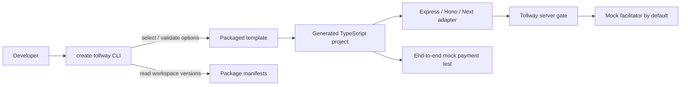

# ADR: create-tollway scaffolder

- **Status:** Accepted 2026-11-18
- **Date:** 2026-11-18
- **Issue:** #257
- **Scope:** New publishable `packages/create-tollway`, its three packaged templates and generated-project checks, plus user docs, README, changeset, and release note. Existing adapters and example apps are not modified.

## Context

Tollway has published-workspace candidates for Express, Hono, and Next App Router, but no package that assembles them into a runnable first project. `packages/adapter-next/package.json` currently supports Next 14 and 15, so the template will target Next 15. `@vegaforge/tollway-server` exports `createMockFacilitator`; the adapter APIs are `expressPaywall`, `honoPaywall`, and `withPaywall`. The monorepo uses pnpm and package versions are currently declared in each workspace `package.json`.

The scaffolder must be usable offline after installation, must not create secrets, and must test generated projects against locally packed workspace tarballs before publication.

## Decision

1. Create an unscoped `create-tollway` package with a `create-tollway` executable and minimal Node built-in CLI dependencies: `node:util` `parseArgs` and `node:readline/promises`.
2. Support `--template express|hono|next`, `--dir`, `--package-manager`, `--yes`, and `--force`. Prompt interactively only when required options are absent and stdin is interactive.
3. Ship real TypeScript templates under `packages/create-tollway/templates/`; include one paid route, mock mode enabled by default, testnet `.env.example`, README, and an end-to-end mock payment test per template.
4. Substitute dependency versions from workspace package manifests when creating the project. Use supported Next 15 versions and current package peer ranges; never emit `workspace:*`, `latest`, or generated secret material.
5. Refuse a non-empty output directory unless `--force` is supplied. Even with force, never overwrite an existing `.env` and never write private keys.
6. Test the CLI parser, safe directory behavior, and version substitution. For all three templates, pack current workspace dependencies, install those tarballs in a temporary generated project, then run typecheck and tests.
7. Keep templates in source control as type-checked source. Configure repository tooling so template sources are checked without treating their generated package dependencies as undeclared root dependencies.

## Diagram

## Consequences

New users get a repeatable offline scaffold and a test that demonstrates a verified receipt without requiring a wallet or testnet funds. The package must maintain three templates and a tarball integration harness. Generated projects use mock settlement until the operator intentionally supplies a real facilitator and signer.

## Alternatives considered

- **Copy one example app:** rejected because the examples are standalone applications and should not become duplicated scaffolder templates.
- **Use a prompt framework:** rejected because the required prompts fit Node's built-in readline API and a framework adds runtime weight.
- **Generate from strings embedded in CLI code:** rejected because templates would not be independently type-checked and could drift.
- **Use workspace protocol versions in output:** rejected because generated projects must install both from current local tarballs and after publication.

## Verification

Add unit tests for argument parsing, empty/non-empty directory handling, `.env` preservation, and version substitution. For Express, Hono, and Next, scaffold in temporary directories, install the local workspace tarballs, and run generated typecheck and end-to-end tests. Run `./scripts/preflight.sh` and inspect the packed `create-tollway` contents to confirm templates ship.
