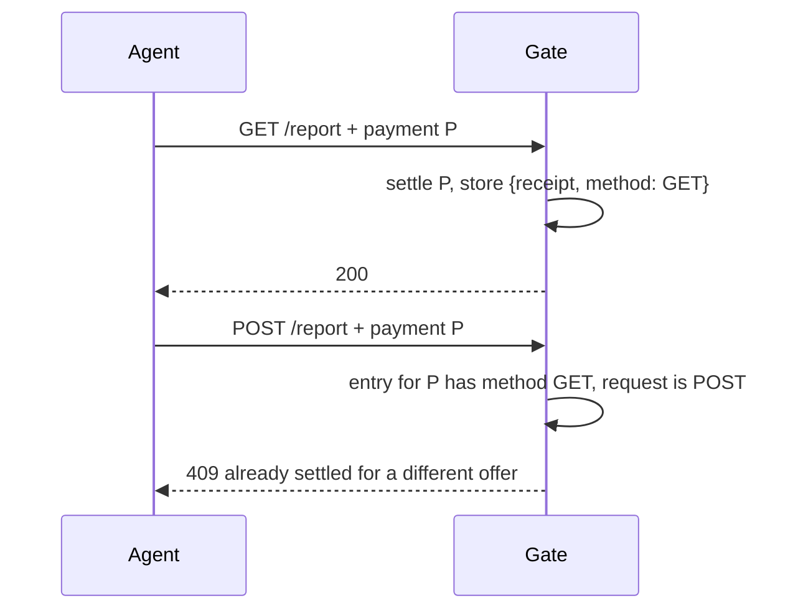

# ADR: Bind a settled payment to the HTTP method it paid for

- **Status:** Accepted 2026-11-18.
- **Date:** 2026-11-18
- **Issue:** none; handled privately under SECURITY.md until this fix was ready.
- **Scope:** `packages/server/src/gate.ts`, `packages/server/src/cache.ts`, their tests, the four adapter test files. The receipt format (v1) does not change.

## Context

`createPaywall` (`packages/server/src/gate.ts`) builds the offer with
`resource: config.resource ?? request.url`. `TollwayRequest.method` is passed
in by every adapter and never read. The binding a cached or in-flight receipt
must match (`offerBinding` / `receiptBinding`) covers `model`, `network`,
`resource`, `amount`, `asset` and `payee`, not the method.

One gate is commonly mounted on several methods of one path: a Next.js route
file exporting `GET` and `POST` with the same gate, `app.all`, Hono's
`app.on([...])`, or Express `app.use(path, ...)`. Then:

1. An agent pays once for `GET /report`.
2. The same `PAYMENT-SIGNATURE` is sent to `POST /report` while the first
   settlement is in flight (or, with a cache, after it).
3. The second request finds the same nonce in the in-flight map or cache. The
   receipt binding matches, because method is not part of it, so the gate
   returns `settled` with `replayed: true` and the POST handler runs.

One payment unlocks every method on the URL. A POST is often the expensive
operation (inference, writes), and the price may differ per method if the
operator uses one gate per method that shares a cache.

## Decision

1. The settlement record carries the request method. The in-flight map and
   the cache store `{ receipt, method }` instead of a bare receipt:
   `SettlementCache.get` returns `SettlementEntry | undefined`, and
   `set(key, entry)` takes one. `SettlementEntry` is exported.
2. A cached or in-flight entry is returned only when `entry.method` equals the
   current request's method (uppercased) and the existing receipt binding
   matches. Otherwise the outcome is the existing `409 payment already settled
   for a different offer`.
3. The cache key stays `<model>:<nonce>`, so a payment still settles at most
   once across methods: a second method gets 409, never a second `/settle`.
4. The Redis cache stores the entry as JSON and validates it on read with a
   strict schema. An entry without `method` (written by an older process
   during a rolling deploy) is treated as a mismatch (409), not a miss, so it
   can never cause a second `/settle`.
5. `resource` in the receipt keeps its current meaning. Putting the method
   into the receipt is the public receipt v2 work and is not done here.

## Diagram

## Consequences

- Operators who mount one gate on several methods now charge per method, as
  they almost certainly expected.
- `SettlementCache` is a public interface and its stored value changes. Custom
  caches must store the entry. Pre-1.0, called out in a minor changeset.
- A Redis entry from before the upgrade is refused rather than served for up
  to the 30 s TTL. Retries of payments made in that window get a 409.

## Alternatives considered

- **Put the method into the cache key.** A second method would then miss and
  call `/settle` again for the same payment, which is the duplicate-settlement
  risk the cache exists to prevent.
- **Put the method into `resource`** (for example `"POST /report"`). Changes
  what every receipt says and what operators match on; that belongs to receipt
  v2 with a migration.
- **Document "one gate per method".** Leaves the default unsafe.

## Verification

Red first, in `packages/server/src/gate.test.ts`:

1. Same payment, `GET` then `POST` on one gate with a cache: the POST must be
   rejected (fails today: settled with `replayed: true`).
2. Same payment sent concurrently as `GET` and `POST`: exactly one settles,
   the other is rejected, `/settle` runs once (fails today).
3. A Redis entry without `method` is refused with 409 and does not call
   `/settle`.

Then the same case through all four adapters, the full suite, and
`./scripts/preflight.sh`.
