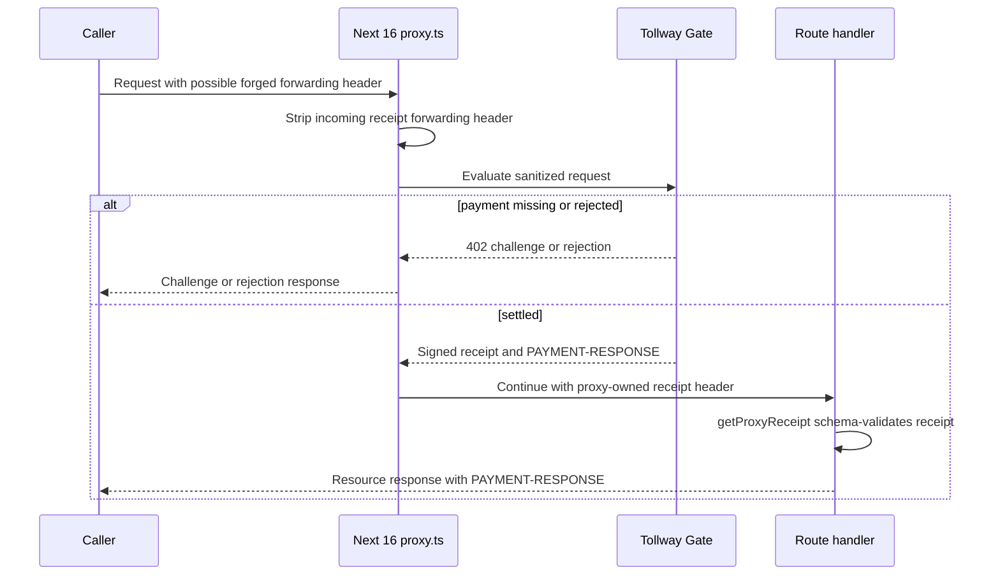

# ADR: Next.js 16 proxy paywall

- **Status:** Accepted 2026-11-18
- **Date:** 2026-11-18
- **Issue:** #260
- **Scope:** `packages/adapter-next` peer range, implementation and tests; Next version-matrix CI; README and getting-started documentation. No server payment logic changes.

## Context

`packages/adapter-next/package.json` currently permits Next 14 and 15. Both `apps/web` and `apps/dashboard` declare Next `^16.4.5`. The existing `withPaywall` accepts standard Web `Request`/`Response` and the current test suite includes real `NextRequest` coverage, but the adapter has no version matrix or proxy entry point. Next 16 uses `proxy.ts`; the exact request-header forwarding and runtime contract must be confirmed from the installed Next 16 source before implementing the API.

The security boundary is caller-controlled headers. A client must not be able to supply the receipt header that a proxy later forwards to a route. Receipt forwarding must originate only from a successful gate outcome, and the route helper must parse the forwarded value with Tollway's signed receipt schema.

## Decision

1. Expand the optional peer range to include Next 16 and test `withPaywall` against each supported major with the corresponding installed Next package.
2. Add a proxy entry point that takes configured path-to-gate mappings, answers payment challenges and rejections, and continues matched settled requests and unmatched requests.
3. Treat the proxy as a Next 16 Node runtime integration. Before implementation, inspect the installed Next 16 proxy source and types for how request headers are passed to route handlers and which runtime values are available; encode that contract in an adapter test and fail clearly when the runtime is unsupported.
4. Before invoking a gate, remove any incoming Tollway receipt-forwarding header from the request used by the gate. On settlement, place the gate-produced signed receipt in the downstream request using Next's documented request-header override mechanism. `getProxyReceipt(request)` reads that header and validates it with the core signed receipt schema.
5. Preserve `PAYMENT-RESPONSE` for settled requests. The proxy API must not trust or forward a receipt value supplied by the original caller.
6. Keep path matching and payment behavior limited to adapter configuration; call the existing server `Gate` for each matched route.

## Diagram

## Consequences

Next 16 applications can protect route groups in one proxy while keeping settlement in the framework-agnostic server gate. The adapter takes a dependency on Next's proxy forwarding contract, so the version matrix and installed-source verification become part of maintaining this public entry point. Applications must ensure protected route handlers cannot be reached through a path that bypasses the configured proxy.

## Alternatives considered

- **Keep wrapping every handler:** rejected because it does not address route-group protection and repeats configuration.
- **Trust an incoming receipt header:** rejected because callers can forge request headers.
- **Move payment logic into the proxy adapter:** rejected because adapters only translate requests and gate outcomes; payment logic belongs in `@vegaforge/tollway-server`.
- **Support a proxy runtime without an explicit guard:** rejected because cryptographic APIs and request forwarding may not be available in every Next execution mode.

## Verification

Read the installed Next 16 `proxy.ts` implementation, type declarations, and runtime contract before choosing exact return types. Add a version matrix for `withPaywall` 14/15/16 and proxy tests for matched/unmatched paths, client-forged forwarding headers, rejection, forwarded verified receipt, runtime guard, and `PAYMENT-RESPONSE`. Run `./scripts/preflight.sh` and the generated Next example route flow if available.
