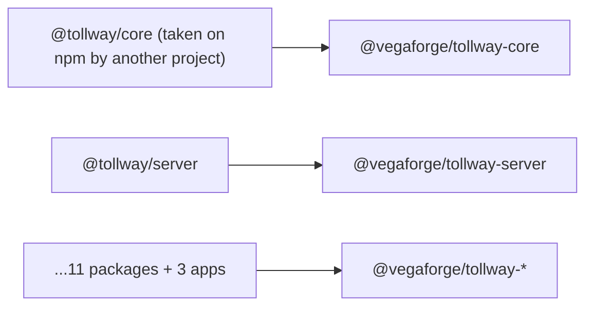

# ADR: Publish under the @vegaforge npm scope

- **Status:** Accepted 2026-11-18
- **Date:** 2026-11-18
- **Issue:** none (maintainer request)
- **Scope:** every `package.json` name and import of `@tollway/*` across `packages/`, `apps/`, docs, changesets, workflows, the lockfile and the website. No behaviour change. Nothing is published by this decision.

## Context

Every workspace package is named `@tollway/<name>` (11 publishable packages,
3 private apps; 301 references in 106 files). The `@tollway` scope on npm
belongs to an unrelated project: `@tollway/server` and `@tollway/client`
0.2.0 were published from `github.com/TollwayProtocol/Tollway` by a
maintainer who is not part of vegaforge (`npm view @tollway/server
repository.url maintainers`). This repository can never publish there, and
anyone who runs `npm install @tollway/server` today gets someone else's code.

The maintainer has decided to use the `@vegaforge` scope, and not to publish
until after the current Drips Wave. Publishing stays a manual run on `main`
(ADR-2026-11-18-branch-flow).

## Decision

1. Publishable packages are renamed `@vegaforge/tollway-<name>`:
   `@vegaforge/tollway-core`, `-client`, `-server`, `-adapter-express`,
   `-adapter-fastify`, `-adapter-next`, `-adapter-hono`, `-channels`,
   `-reconcile`, `-observability`, `-theme`. The `tollway-` prefix keeps
   Tollway's packages distinct from other vegaforge projects (Octroi) in the
   same scope.
2. Private apps become `@vegaforge/tollway-dashboard`, `-demo` and `-web`
   so workspace filters stay uniform. They remain `private: true`.
3. Every import, `pnpm --filter`, changeset front matter, TSDoc reference,
   doc page and README is updated in the same change. The lockfile is
   regenerated with `pnpm install`, not edited by hand.
4. Versions stay at `0.0.1`. No changeset bumps a version for the rename
   (nothing was ever published under these names), and the existing pending
   changesets are rewritten to the new names.
5. The open Wave issues that name `@tollway/*` packages are updated to the new
   names after the change merges, so contributors are not sent to the wrong
   import path.
6. Before the first publish, the maintainer creates the `vegaforge`
   organization on npm. That step is manual and outside this repository.

## Diagram

## Consequences

- Import paths change for everyone: contributors with open branches rebase and
  run a search-and-replace. Nothing published breaks, because nothing was
  published.
- Package names get longer.
- The `@tollway` name confusion on npm goes away for this project's users.

## Alternatives considered

- **`@vegaforge/core`, `@vegaforge/server`.** Shorter, but collides with
  Octroi's packages in the same scope as soon as both publish.
- **Unscoped `tollway-core`.** Unscoped names are first-come on npm and easy
  to typosquat; a scope the maintainer owns is safer.
- **Ask the current `@tollway` owner to transfer the scope.** Possible, but
  depends on a stranger, and the scope already carries their releases.

## Verification

1. `git grep "@tollway/"` returns nothing outside ADRs and release notes that
   describe the old name.
2. `./scripts/preflight.sh` passes, and `MOCK_MODE=true pnpm --filter
   @vegaforge/tollway-demo start` prints a verified receipt.
3. `pnpm -r exec -- npm pack --dry-run` shows the new names with no publish.
