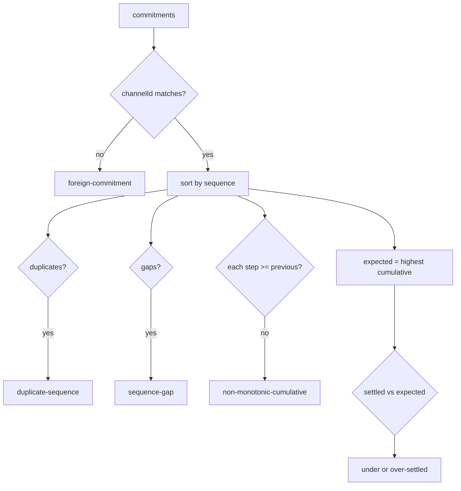

# ADR: Channel reconciliation checks the whole commitment stream, not just its last entry

- **Status:** Accepted 2026-11-18.
- **Date:** 2026-11-18
- **Issue:** none; handled privately under SECURITY.md until this fix was ready.
- **Scope:** `packages/reconcile/src/index.ts`, its unit and property tests, `apps/web/src/content/docs/reconciliation.mdx`. No change to other packages.

## Context

`reconcileChannel(commitments, settlement)` in `packages/reconcile/src/index.ts`
sorts the commitments by sequence, reports the first position where
`sequence !== index` as `sequence-gap`, and then compares only the **last**
commitment's `cumulativeAmount` with `settledAmount`. Three things are never
checked:

1. **Monotonic cumulative amounts.** A stream `0: 100, 1: 40` returns
   `ok: true` if 40 settled. The counterparty was committed 100 and settled 40,
   and reconciliation says nothing. A decrease is the signature of a rolled
   back or tampered store, which is exactly what this engine exists to catch
   (docs/design.md, "Reconciliation": "the safety net that catches a
   counterparty who under-settles").
2. **Channel identity.** A commitment whose `channelId` differs from
   `settlement.channelId` is reconciled as if it belonged to this channel, so
   commitments from another channel can mask a shortfall here.
3. **Duplicate sequences.** Two commitments at one sequence are reported as a
   `sequence-gap` at the next position, which misdescribes the problem and,
   when the duplicates disagree on amount, hides which value was used.

## Decision

1. `DriftKind` gains `non-monotonic-cumulative`, `foreign-commitment` and
   `duplicate-sequence`. Each has a detail that names the sequences and
   amounts involved.
2. Commitments whose `channelId` differs from the settlement's are reported as
   `foreign-commitment` and excluded from every amount check, so they can
   neither cause nor hide drift.
3. Duplicate sequences are reported as `duplicate-sequence`. When duplicates
   disagree on amount, the highest amount is used for the settlement
   comparison, so ambiguity can only produce more drift, never less.
4. Every step `i > 0` must satisfy `cumulative[i] >= cumulative[i-1]`;
   the first violation is reported as `non-monotonic-cumulative`.
5. The settlement comparison uses the highest cumulative seen in the stream,
   not the last entry, so a decreasing tail cannot lower the expected
   settlement.
6. Existing drift kinds and their detail text are unchanged, so current
   `suppress` hooks keep working.

## Diagram

## Consequences

- Streams that were silently accepted now produce drift. That is the fix.
- `DriftKind` is a public union; a caller with an exhaustive `switch` gets a
  compile error and must handle the new kinds. Pre-1.0, minor changeset.

## Alternatives considered

- **Throw on malformed streams.** Reconciliation reports; it does not throw
  on data it was asked to judge. Drift items are the contract.
- **Validate in the channel manager instead.** The manager is one producer of
  streams; the reconciler must not trust any producer.

## Verification

Red first, in `packages/reconcile/src/reconcile.test.ts`:

1. A decreasing stream settled at its last value must report drift (fails
   today: `ok: true`).
2. A stream containing a commitment from another channel must report
   `foreign-commitment` and must not use its amount (fails today).
3. A duplicate sequence must report `duplicate-sequence`, not
   `sequence-gap` (fails today).

Extend `reconcile.property.test.ts`: for any stream where some step decreases,
the result is never `ok: true`. Then the full suite and
`./scripts/preflight.sh`.
