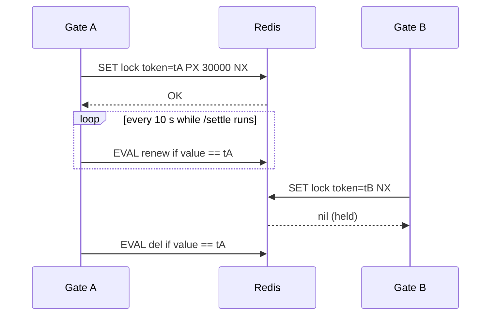

<!--
  EMBARGOED SECURITY RECORD. DO NOT PUSH THIS BRANCH OR OPEN A PUBLIC PULL REQUEST
  until the maintainer decides the disclosure step. Lives only in
  .worktrees/security-fixes (branch fix/security-embargo).
-->

# ADR: Redis settlement locks are owned, renewed, and released only by their holder

- **Status:** Accepted 2026-11-18. **Embargoed: keep local.**
- **Date:** 2026-11-18
- **Issue:** none filed on purpose (SECURITY.md).
- **Scope:** `packages/server/src/cache.ts`, `packages/server/src/gate.ts`, their tests. No change to `@vegaforge/tollway-core` or the adapters.

## Context

The gate takes a cross-process lock before calling `/settle` when the cache
implements `acquire` and `release` (`settleOnce` in `packages/server/src/gate.ts`).
`createRedisSettlementCache` (`packages/server/src/cache.ts`) implements them as:

- `acquire(key, ttlMs)`: `SET <prefix>lock:<key> "1" PX ttlMs NX`.
- `release(key)`: `DEL <prefix>lock:<key>`, with no check of who holds it.

The lock TTL is `SETTLEMENT_LOCK_TTL_MS = 30_000`. `@x402/core`'s
`HTTPFacilitatorClient` calls `fetch` with no timeout, so a slow `/settle` can
outlive the lock. Then:

1. Process A acquires the lock and calls `/settle`, which hangs.
2. After 30 s the lock expires. Process B receives a retry of the same payment,
   misses the cache (A has not written it), acquires the lock and calls
   `/settle` for the same payment.
3. A finishes and its `release` deletes B's lock. Process C can now acquire
   and settle a third time.

Every value is `"1"`, so nothing can tell holders apart. Facilitators are
known to be vulnerable to duplicate `/settle` submissions (docs/design.md,
"Duplicate protection"), which is exactly what the lock exists to stop. The
outcome is a payer charged more than once for one payment.

## Decision

1. `acquire` stores a random per-acquisition token
   (`crypto.randomUUID()`) instead of `"1"`, and returns a lock handle
   `{ token }` on success or `false` when held. The gate passes the handle back
   to `release` and `renew`.
2. `release(key, handle)` deletes the lock only if its value still equals the
   token, atomically, with a Lua compare-and-delete through `EVAL`. Releasing a
   lock you no longer hold is a no-op that reports `false`, not an error.
3. New `renew(key, handle, ttlMs)` extends the TTL only if the token still
   matches (Lua compare-and-`PEXPIRE`). While a settlement is in flight the gate
   renews the lock every `ttl / 3`. If a renewal reports the lock was lost, the
   gate records a `cacheError`-style signal (`lockLost`) on the outcome and
   through `onCacheError`, so an operator sees that duplicate protection was
   not held for the whole settlement.
4. `RedisLikeClient` gains `eval(script, numKeys, ...args)`, matching ioredis.
   This is a breaking change to the duck-typed client and is called out in the
   changeset. The in-memory cache does not implement locks and is unchanged.
5. The renewal timer is cleared in a `finally`, never keeps the process alive
   (`unref` where available), and never throws into the request.

## Diagram

## Consequences

- A slow facilitator no longer opens a window for a second settlement while
  the first holder is alive. If the holder dies, the TTL still frees the key.
- Custom `RedisLikeClient` implementations must add `eval`. ioredis and
  ioredis-mock already have it.
- One extra Redis round trip every 10 s per in-flight settlement.

## Alternatives considered

- **Raise the TTL.** Directive 4 forbids raising a TTL to hide a problem, and
  any fixed TTL can still be outlived.
- **Check-then-delete without Lua.** `GET` then `DEL` is not atomic; the lock
  can change hands between the two calls.
- **Redlock across several Redis nodes.** Solves a different problem (Redis
  failover) at a large complexity cost. Out of scope.

## Verification

Red first, in `packages/server/src/cache.test.ts` and `gate.test.ts`:

1. A process whose lock expired cannot release a lock now held by another
   process (fails today: `release` deletes it).
2. With a `/settle` that takes longer than the lock TTL and a second process
   retrying, `/settle` runs once (fails today: twice).
3. `renew` on a lost lock reports `false` and the outcome carries `lockLost`.

Then green, the full suite, and `./scripts/preflight.sh`.
