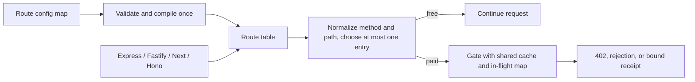

# ADR: Framework-agnostic paid route table

- **Status:** Accepted 2026-11-18
- **Date:** 2026-11-18
- **Issue:** #261
- **Scope:** `packages/server` route-table compiler and matching tests; route-table entry points/tests in all four adapters; README and web docs; changesets and release notes. No payment protocol or facilitator changes.

## Context

`createPaywall(config, deps)` in `packages/server/src/gate.ts` constructs one gate for one offer. Express, Fastify, Next, and Hono adapters each accept one `Gate`. A service with several paid resources must currently repeat configuration and cannot audit its prices from one public object. Each call to `createPaywall` also creates its own in-flight map, so independently built gates do not share process-local duplicate coordination.

The route table must stay inside the server package, use Tollway types rather than importing x402 server config types, and preserve offer-bound receipts across routes. Matching and resource normalization are security-sensitive because a payment authorized for one route must never unlock another.

## Decision

1. Add `createRouteTable(routes, deps)` in the framework-agnostic server. Routes are keyed by `"<METHOD> <pattern>"`, with a `PaywallConfig` per entry. The returned table exposes `match(method, url)`, `list()`, and an immutable configured-route view for adapters and discovery.
2. Compile once and validate at construction. Reject normalized duplicate keys, unsupported methods, invalid amounts, and overlapping patterns whose precedence would be ambiguous. Errors are `TollwayError`s naming the route entry.
3. Define one canonical path normalizer for matching and default receipt resources: remove query and fragment, normalize percent-encoding for unreserved characters, and remove trailing slashes except for `/`. A route may set an explicit stable `resource`; otherwise the receipt uses the normalized concrete pathname.
4. Match exact static paths first, then the route with the longest static prefix. Parameter segments use `:name`; overlapping parameter patterns with equal precedence are rejected at construction. Methods must match exactly after uppercasing. Unmatched requests are free and pass through without invoking a gate.
5. Build all route gates from the table's one settlement cache and one in-flight map. Refactor gate construction around an internal shared settlement context while keeping existing `createPaywall(config, deps)` behavior and public signature intact.
6. Add a route-table middleware entry point for Express, Fastify, Next, and Hono. Adapters pass method and URL into the table and retain their existing outcome handling and error behavior for matched routes.
7. Keep payment identity bound to the matched entry's offer. A cached or concurrent result for another resource, price, asset, payee, network, or model remains a 409; tests explicitly replay a payment across entries.
8. Test matcher precedence, path normalization, and uniqueness, including a property-style set of patterns/requests that asserts no request selects more than one entry. Test every adapter's matched/free/error paths.

## Diagram

## Consequences

Operators get one auditable route-and-price list, and discovery or dashboard callers can inspect it without reaching into framework routers. Matching rules become part of the server's public API and must remain stable. Sharing settlement context requires a small gate refactor, but it ensures duplicate protection applies across every route in one table.

## Alternatives considered

- **Construct a gate for every entry in user code:** rejected because configuration remains scattered and in-flight deduplication remains per gate.
- **Put route matching inside each adapter:** rejected because matching behavior could diverge across frameworks and would place payment-related policy in adapters.
- **Import x402 `RoutesConfig`:** rejected because Tollway's public configuration should remain protocol-agnostic.
- **Use a third-party router:** rejected because its path normalization and precedence would add an opaque security dependency.

## Verification

Write failing route-table validation, matcher, normalization, cache-sharing, and cross-route replay tests first. Run the matcher property-style tests and conformance tests through Express, Fastify, Next, and Hono, including free and rejection paths. Run `./scripts/preflight.sh` and hand-check one matched and one free route in the demo or a focused fixture.
