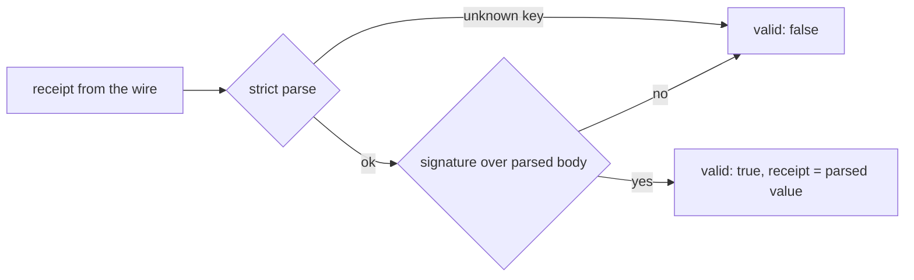

# ADR: A verified receipt is exactly the signed receipt

- **Status:** Accepted 2026-11-18.
- **Date:** 2026-11-18
- **Issue:** none; handled privately under SECURITY.md until this fix was ready.
- **Scope:** `packages/core/src/receipt/schema.ts`, `packages/core/src/receipt/receipt.ts`, `packages/client/src/index.ts`, their tests, `docs/receipt-format.md`. The signed bytes and the receipt format do not change.

## Context

`signedReceiptSchema`, `receiptBodySchema` and `receiptSignatureSchema`
(`packages/core/src/receipt/schema.ts`) are plain `z.object`, which in zod 4
drops unknown keys while parsing. `verifyReceipt` (`receipt.ts`) parses the
candidate, canonicalises the parsed body, checks the signature, and returns
only `{ valid: true }`.

So a receipt with extra fields that the signature never covered, for example
`receipt.refunded: "true"` or `receipt.note: "paid in full"`, verifies as valid.
The caller still holds its own input object, extra fields included.
`@vegaforge/tollway-client` does exactly that: `pay()` verifies `receipt` and then
returns and emits that same unverified object to the agent
(`packages/client/src/index.ts`).

Signed fields cannot be forged, so the amount, payee and settlement reference
are safe. The risk is any consumer (accounting, dispute evidence, dashboards)
that reads a field the signature does not cover and trusts it because
"`verifyReceipt` said valid".

## Decision

1. The three receipt schemas become strict (`z.strictObject`): an unknown key
   anywhere in the body or the signed envelope fails parsing with a clear
   path, so `verifyReceipt` returns `{ valid: false }`.
2. `verifyReceipt` returns `{ valid: true, receipt: SignedReceipt }` with the
   parsed value, and its TSDoc says callers must use that value, not their
   input. `ReceiptVerification` is widened accordingly (additive for callers
   that only read `valid`).
3. `@vegaforge/tollway-client` returns and emits the verified receipt when a verifier is
   configured, and the parsed receipt (schema-checked, signature not checked)
   when it is not, so `pay()` never hands back raw settler output.
4. Everything that parses receipts from outside (the Redis settlement cache,
   the dashboard seam) keeps working, because Tollway never writes extra keys.
   A foreign Redis entry with extra keys becomes a cache miss, as other
   malformed entries already are.

## Diagram

## Consequences

- A receipt with any extra field is now rejected, even if harmless. That is
  the intended trade: a verified receipt means every byte was signed.
- `verifyReceipt`'s return type gains a field. Callers that narrow on
  `valid` keep compiling.

## Alternatives considered

- **Keep stripping, but return the parsed value.** Callers that ignore the
  return value would still trust their input. Rejecting is the only behaviour
  that is safe by default.
- **`passthrough` and sign everything.** Changes the signed bytes and breaks
  every existing receipt.

## Verification

Red first, in `packages/core/src/receipt/receipt.test.ts` and
`packages/client/src/client.test.ts`:

1. A correctly signed receipt with an extra body field and an extra top-level
   field must fail verification (fails today: `valid: true`).
2. `pay()` must not return an object carrying fields the signature did not
   cover (fails today).
3. An existing receipt with no extra fields still verifies, byte for byte.

Then the full suite and `./scripts/preflight.sh`.
