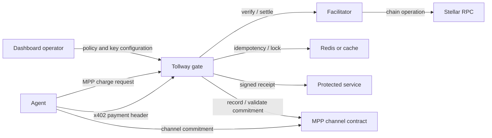

# ADR: Threat model and abuse-case verification

- **Status:** Accepted 2026-11-18
- **Date:** 2026-11-18
- **Issue:** #256
- **Scope:** `docs/threat-model.md`, security/design links, server and core abuse-case tests, and a CI cross-check that every defended case has a test. No payment behavior changes are proposed.

## Context

`docs/design.md` describes the security model briefly, while `SECURITY.md` sets reporting scope. Neither provides a path-by-path threat model. The repository standards require boundary validation, receipt-to-offer binding, replay protection, and awaited writes. Issue #256 identifies repeated headers and unbounded header decoding as candidate abuse paths and requests tests for gate and receipt defenses.

The server owns settlement and gate behavior; core owns receipt schemas and signing primitives. The threat model must follow those implementation boundaries and must distinguish verified defenses from partial or open work. If tests expose a previously unknown security defect, it must be reported privately using `SECURITY.md`; the public table will identify the case as open without disclosing exploit details.

## Decision

1. Add `docs/threat-model.md` covering assets, trust boundaries, attacker capabilities, x402/MPP charge/MPP channel flows, abuse cases, mitigations and status, out-of-scope risks, and review cadence.
2. Give each abuse case a stable identifier, likelihood, impact, linked mitigation/status, and a test reference for defended cases. Open cases link to their owning issue.
3. Organize relevant tests in `packages/server` and `packages/core` with one `describe` per case id. Include the required replay, offer binding, concurrency, receipt integrity, and header-input cases.
4. Add a deterministic check that extracts defended case ids from the threat model and verifies matching test declarations; run it in CI and the normal test command.
5. Link the threat model from `SECURITY.md` and the Security model section in `docs/design.md`.
6. Do not change production payment behavior under this issue. Any newly discovered defect follows private reporting and is tracked as open until separately fixed.

## Diagram

## Consequences

The security claims become reviewable and tied to executable tests. A parser-based cross-check adds maintenance coupling between the table and test names, so the document format and check must remain intentionally small and documented. Documentation can expose system boundaries without publishing details of an unreported vulnerability.

## Alternatives considered

- **Keep the current paragraph and add scattered tests:** rejected because operators and reviewers would still lack an inventory of trust boundaries and uncovered abuse paths.
- **Use generic STRIDE categories:** rejected because the issue asks for concrete Tollway assets, code paths, mitigations, and test evidence.
- **Make every documented abuse path a test:** rejected because open paths must not be represented as skipped or expected-to-fail tests. Only defended claims receive test references.

## Verification

Write the abuse-case tests first and confirm each existing defense. Validate the cross-check against the table and suite. Run affected package tests, then `./scripts/preflight.sh`; inspect that CI invokes the same cross-check. No network is required for the abuse suite. A manual production payment flow is not applicable because this ADR proposes no behavior change.
