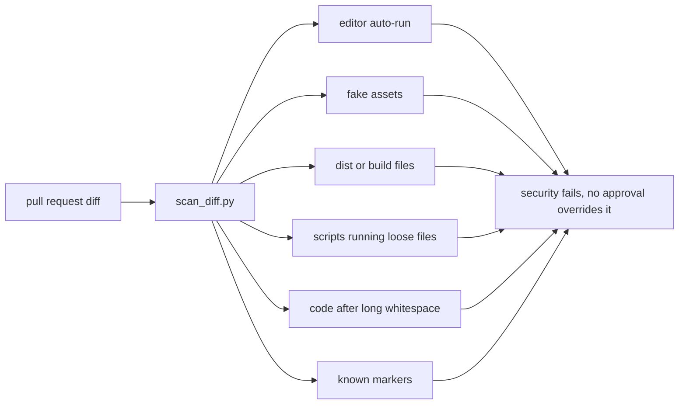

# ADR: Hard-fail the malware indicators Drips reported after Wave 10

- **Status:** Accepted 2026-11-18
- **Date:** 2026-11-18
- **Issue:** none (maintainer request, after the Drips Wave 10 advisory)
- **Scope:** `scripts/security/scan_diff.py` and `test_scan_diff.py` in Tollway, Octroi and Evergreen (the three copies are the same scanner). Extends ADR-2026-10-29-pr-security-gate; no workflow or ruleset change.

## Context

After Wave 10, Drips warned maintainers about malicious pull requests in Wave
repositories and listed indicators:

1. `.vscode/tasks.json` with a `runOn: folderOpen` task (often running node,
   curl or wget), and `task.allowAutomaticTasks: "on"` in `.vscode/settings.json`.
2. Font files such as `fa-solid-500.woff2`, `fa-solid-600.eot`,
   `fa-solid.lik`, `fa-solid-300.ttf`.
3. `dist/setup.js`, or `preinstall: "node dist/setup.js"`.
4. An `api.js` run by `start` or `dev` scripts.
5. Code appended to `postcss`, `tailwind`, `eslint`, `next`, `jest` or `vite`
   config files after a long stretch of whitespace.
6. Markers `rmcej%otb%`, `Cot%3T=sthP`, `_$__1e42`.

Repositories that merge confirmed malware are removed from the Wave.

What the `security` check does today against each, verified in
`scripts/security/scan_diff.py` and `.github/security/sensitive-paths.txt`:

| Indicator | Today |
| --------- | ----- |
| 1. `.vscode/**` | sensitive path: passes once a maintainer approves the commit; nothing inspects the content |
| 2. fake font files | a real font in `public/**` or `assets/**` passes. A **text** file named `*.woff2` is neither binary nor a code extension, so no check reads it at all |
| 3. `preinstall` | fails (lifecycle scripts). A committed `dist/setup.js` is only scanned as ordinary code |
| 4. `api.js` + scripts | `package.json` is a sensitive path (approval); no content rule |
| 5. appended config code | config files need approval; a line over 1000 characters fails, but code after 200 spaces on a 300-character line passes |
| 6. markers | no rule |

So indicators 1, 2, 5 and 6 can pass with one careless approval, and 2 can
pass with none.

## Decision

New findings in `scan_diff.py`, each failing the check regardless of who
wrote the pull request or who approved it:

1. **Editor auto-run.** In `.vscode/tasks.json` (and `*.code-workspace`), any
   task with `runOptions.runOn` set to `folderOpen` (also matched as plain
   text, so JSON with comments cannot hide it). In `.vscode/settings.json` and
   `*.code-workspace`, any `task.allowAutomaticTasks` value other than `off`.
2. **Fake assets.** A file whose extension is a font or image type (`.woff`,
   `.woff2`, `.ttf`, `.otf`, `.eot`, `.png`, `.jpg`, `.jpeg`, `.gif`, `.webp`,
   `.ico`) must start with that type's magic bytes. A text file, or a file
   whose content is a different type, fails. `.lik` files fail outright, and
   so does any added file named `fa-solid*` or `fa-regular*`.
3. **Committed build output.** Any added file with a `dist/` or `build/`
   directory segment fails. None of the three repositories commits one today
   (checked with `git ls-tree`; Tollway and Octroi also ignore `dist/` in
   `.gitignore`), so a committed one is either a mistake or a payload.
4. **Scripts that run a loose file.** In `package.json`, a `start`, `dev`,
   `build`, `test`, `serve` or `preview` script that runs `node` on a `.js` or
   `.cjs` file outside `scripts/` fails with a message naming the file.
5. **Hidden trailing code.** In code and config files (the existing
   `CODE_EXTENSIONS` plus `.json`, `.jsonc`, `.yaml`, `.yml`, `.toml`), an
   added line with a run of 60 or more spaces or tabs followed by more code
   fails. Markdown is excluded, because table padding is normal there.
6. **Known markers.** Any added line containing `rmcej%otb%`, `Cot%3T=sthP` or
   `_$__1e42` fails, in every text file.

Each rule gets red-then-green tests in `test_scan_diff.py`, including a
negative case that must still pass (a real WOFF2 in `public/`, a
`folderOpen` string in Markdown docs, a padded Markdown table).

The same change lands in Octroi and Evergreen as their own pull requests,
since each repository's `security` check reads its scanner from the base
branch.

## Diagram

## Consequences

- The indicators Drips listed can no longer be approved by accident.
- A legitimate `.vscode/tasks.json` with `folderOpen` (rare) has to be added by
  the maintainer and the rule narrowed with a test, per AGENTS.md.
- New variants will appear; these rules are known patterns, not a guarantee.
  The review rules in AGENTS.md (read the diff on GitHub before running
  anything; install with `--ignore-scripts`) still apply.

## Alternatives considered

- **Rely on sensitive-path approval.** One rushed approval is exactly how
  Wave repositories got caught.
- **Semgrep rules only.** Semgrep does not read `.woff2` or JSON-with-comments
  files, and the whitespace trick targets reviewers, not parsers.

## Verification

1. One failing test per rule (red), then the implementation (green), then the
   existing scanner tests still pass.
2. A throwaway pull request per repository with a fake `fa-solid-500.woff2`
   text file, a `folderOpen` task and a padded config line: `security` fails.
3. All open pull requests in the three repositories still pass.
