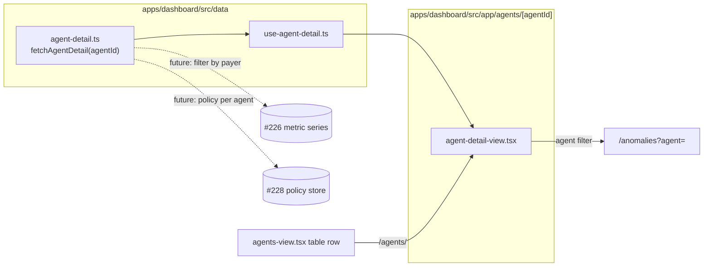

# ADR: Agent detail page data seam and budget rendering

- **Status:** Accepted 2026-11-19
- **Date:** 2026-11-19
- **Issue:** #236
- **Scope:** `apps/dashboard` only: new data module and hook, a `/agents/[agentId]` route and view, a link from the agents table, and `docs/dashboard-data-contracts.md`. No `packages/*` source changes, so no changeset. No new dependencies, config files, or workflow changes.

## Context

`apps/dashboard/src/app/agents/agents-view.tsx` renders a sortable table of `AgentSpendRow` values supplied by the deterministic stub in `apps/dashboard/src/data/agent-spend.ts:49-82`. The headline totals call `sumAmounts` (`agents-view.tsx:42-44, 61-70`) across every row and label the result with `headlineAsset(rows)`, the first row's asset (`agents-view.tsx:46-48, 68`). Any multi-asset stub therefore produces a total in one asset's unit that includes another asset's base units. The page lead promises "spend over time, model mix, and budget usage, with anomaly stops surfaced inline", and none of that exists.

The data model has three gaps that shape the seam:

- `Policy` (`packages/core/src/policy.ts:11-37`) has `budgets.daily` (per UTC day) and `budgets.total` but no agent identity. Which policy governs which agent is decided by whoever constructs the engine; #228 will store policies per agent id.
- `PaymentIntent` (`packages/core/src/policy.ts:40-46`) has no payer. `PaymentMetric.payer` (`packages/observability/src/index.ts:31-41`) is the payer address, so the page must map agent id to payer address(es) explicitly rather than infer it.
- `createPolicyEngine` keeps daily, total, and per-service spend in `Map`s keyed by asset and `payee:asset` (`packages/core/src/policy.ts:74-79, 89-101`), and `utcDate` (`policy.ts:56-58`) defines the UTC day as `new Date(clock()).toISOString().slice(0, 10)`. The budget UI must use the same definition.

`docs/dashboard-data-contracts.md` is the existing contract document. Navigation lives in `apps/dashboard/src/components/shell/nav.ts:16-59`. As of this ADR, #191 (budgets keyed by asset), #193 (policy zod schema), #226 (series filtered by payer), #228 (policy per agent), #239 (auth), and #240 (Playwright) have not landed: there is no policy schema or `policyVersion` anywhere in the tree, no `proxy.ts`, and no Playwright dependency.

## Decision

1. Add `apps/dashboard/src/data/agent-detail.ts` exporting an `AgentDetail` type and `fetchAgentDetail(agentId: string): Promise<AgentDetail>`. The type carries identity (`id`, `label`, `payerAddresses: string[]`), settled spend as a time series per asset, spend by model, spend by payee, the current policy with its usage (or `null` when the agent has none), and recent policy-stop events. A deterministic stub backs the first implementation; the function signature is the seam #226 and #228 will fill.
2. The agent-to-payer mapping is explicit data in the stub, keyed by agent id. The page never derives a payer address from an agent id by string convention.
3. Add `apps/dashboard/src/data/use-agent-detail.ts` following the loading/ready/error pattern of `apps/dashboard/src/data/use-agent-spend.ts`, so the view and its tests can mock one hook.
4. Add `apps/dashboard/src/app/agents/[agentId]/page.tsx` and an `agent-detail-view.tsx` client view. The time series is rendered per asset with a selectable bucket (`hour`, `day`) and range. Bucketing and totals count only metrics whose `outcome` is `settled`.
5. Budget usage computes percentages with `bigint` arithmetic, multiplying before dividing, and converts to a display value only afterwards. The daily window is labelled as a UTC day, matching `utcDate` in `packages/core/src/policy.ts`. Per-service caps show their usage. Amounts remain integer base-unit strings; the view states that the policy's single-number budget unit is ambiguous until #191 lands and renders the value the policy declares.
6. An agent with no policy renders an explicit "no policy" state, not an empty budget bar.
7. Recent policy stops list the rule name and detail and link to the anomalies view with an `agent` filter for this agent.
8. The agents table links each row to `/agents/<id>`. Headline totals stop summing across assets: they are grouped by asset or removed if a group cannot be shown honestly.
9. `docs/dashboard-data-contracts.md` gains the agent detail contract, including the agent-to-payer mapping.

## Diagram

## Consequences

- The dashboard gains a real per-agent view without waiting on #226, #228, or #191; swapping the stub for real callers stays a one-module change.
- Multi-asset agents are rendered honestly, one series per asset, at the cost of more UI than a single summed chart.
- Showing the unit ambiguity until #191 is a deliberate, visible caveat rather than a silently wrong percentage.
- The no-policy and empty-series states need their own tests and markup.
- The explicit agent-to-payer map must be extended whenever a new agent appears; that is preferable to a guessed mapping that could attribute spend to the wrong agent.

## Alternatives considered

- **Sum all assets into one series.** Rejected: base units are asset-specific, so the sum is meaningless, and it reproduces the headline bug this issue asks to fix.
- **Compute percentages as JavaScript numbers.** Rejected: loses precision on large base-unit values; the repository requires integer base units summed and compared as `bigint`.
- **Derive payer address from agent id by a naming rule.** Rejected: the issue explicitly requires an explicit mapping; a convention would misattribute spend.
- **Wait for #226 and #228 before building the page.** Rejected: the issue requires a deterministic stub and a stable seam now.
- **Block on #191 and key budgets by asset.** Rejected: #191 is still open; render what the policy says and note the ambiguity instead.

## Verification

Red first: view tests for no policy, multi-asset, budget at 0%, 100%, and over 100%, plus unit tests for bigint percentage math and hour/day bucketing, written against the current code and confirmed failing for the missing feature. Green: smallest production change that satisfies them. Then run `pnpm --filter @vegaforge/tollway-dashboard test`, `pnpm typecheck`, and `./scripts/preflight.sh` in full. Exercise the flow by starting the dashboard and opening an agent row, switching bucket and range, and following a policy-stop link to the filtered anomalies view.
