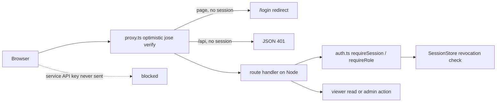

# ADR: Dashboard authentication with server-side sessions and roles

- **Status:** Proposed, awaiting maintainer approval
- **Date:** 2026-11-19
- **Issue:** #239
- **Scope:** `apps/dashboard` only: a `proxy.ts`, login and session route handlers, a server-only session module, small shell changes for the signed-in user, docs, tests, and a release note. New dependencies touch `apps/dashboard/package.json` and `pnpm-lock.yaml`, which are sensitive paths. No `packages/*` source changes, so no changeset.

## Context

`apps/dashboard/src/app/layout.tsx:30-39` wraps every page in `ThemeProvider` and `DashboardShell` with no authentication. There is no `proxy.ts` or `middleware.ts` in the worktree, no route handler under `apps/`, and no session, cookie, CSRF, or role code. `apps/dashboard/src/components/shell/nav.ts:16-59` lists the routes currently open to anyone who can reach the dashboard.

`apps/dashboard/package.json:15-23` has no auth library. `npm view` on 2026-11-19 reported `jose` 6.2.18 and `bcryptjs` 3.0.3. `jose` works in the Edge runtime and can sign and verify a compact JWS; `bcryptjs` is a maintained pure-JavaScript password hash with no native build script, so `pnpm-workspace.yaml` install-script allowlists do not need to change.

The issue requires an optimistic check in Next.js 16 `proxy.ts` and an authoritative check in each route handler or server action. Route handlers must answer 401 without a session, while pages redirect to a login route. Sessions must be HttpOnly, Secure, SameSite=Lax or stricter, expire, and be revocable server side. Two roles are required: `viewer` reads, `admin` reads and performs actions. UI hiding is not authorization.

Issue #237, the typed service client, is still open, and data is still deterministic stubs. This ADR does not depend on live service data. The service API key must stay server side when #237 lands; no browser component may reference it. The identity provider stays in the dashboard deployment, separate from service API-key tenancy (#231).

## Decision

1. Add `jose` and `bcryptjs` as dependencies of `@vegaforge/tollway-dashboard`, pinned through the lockfile. Verify their APIs against the installed source and current docs before coding.
2. Configure users through server-side environment variables, for example `DASHBOARD_USERS` containing a JSON array of `{ username, role, passwordHash }`. Document generation of the hash with `bcryptjs`. Never commit a real password or hash; add only an `.env.example` shape.
3. Use `jose` HS256 with `DASHBOARD_SESSION_SECRET` for a compact session token carrying a session id, username, role, and expiry. The cookie is named `tollway_dashboard_session`, HttpOnly, Secure outside development, SameSite=Lax, path `/`, with an eight-hour maximum age.
4. Keep a server-only in-memory `SessionStore` keyed by session id. It records expiry and revocation so logout and admin revocation are authoritative. A restart invalidates sessions; document that a multi-instance deployment needs a shared store before production use.
5. Add `apps/dashboard/proxy.ts` exporting `proxy`. Its matcher covers pages and `/api/**`, excluding only the login route and static assets. It verifies signature and expiry with `jose`, redirects unauthenticated page requests to `/login?next=<path>`, and returns JSON 401 for `/api/**`. It does not grant authority; every handler re-checks the session.
6. Add `apps/dashboard/src/lib/auth.ts` and `src/lib/session-store.ts`, both server-only. Expose `requireSession`, `requireRole`, `issueSession`, and `revokeSession`. A viewer cannot call an admin helper by crafting a request.
7. Add a login page and route handler, a logout handler, `GET /api/session` for the current identity, and `DELETE /api/admin/sessions/[sid]` as the first real admin-only action. Each handler calls `requireSession` or `requireRole` before doing work. No service API key is read in a client component.
8. Enforce CSRF on state-changing route handlers by checking the request `Origin` against the request host and requiring a session-bound token. Use a uniform "invalid credentials" message for unknown users and wrong passwords, and rate-limit login attempts in memory per username and client address.
9. Show the signed-in username and role in the shell and a logout control. Hide admin controls from viewers, while keeping the server checks as the authority.
10. Add a dashboard security section covering setup, roles, session lifetime, revocation, rate limits, and the rule that the service API key never reaches the browser. Add a release note. Sensitive paths need maintainer approval on the latest commit.

## Diagram



## Consequences

- Every dashboard page and handler requires a session, and admin actions are enforced on the server.
- Login rate limits and revocation live in process memory, so they reset on restart and need a shared store for multiple instances.
- Two new dependencies and a workflow-adjacent config surface require sensitive-path review.
- #240 browser tests must add login and logout coverage once this lands.
- Role checks are centralised, which makes future service-backed admin calls easy to guard.

## Alternatives considered

- **Auth.js or NextAuth.** Rejected for a minimal self-hosted change: broader dependency and configuration surface than the single-team credential provider needs.
- **HTTP Basic auth.** Rejected: no sessions, expiry, server-side revocation, or role checks.
- **Hand-rolled password hashing.** Rejected: the issue requires a maintained vetted algorithm.
- **UI-only role hiding.** Rejected: a crafted request would reach the action.
- **Trust `proxy.ts` alone.** Rejected: the issue and current guidance require authoritative handler checks.
- **Put the service API key in a client environment variable.** Rejected: anyone could read it.

## Verification

Red first: write tests that show today's open routes and handlers lack protection. Confirm signed-out page requests do not redirect, a direct `GET /api/session` does not return 401, a viewer can reach the admin session revocation handler, expired and revoked tokens still pass, CSRF and rate-limit checks are absent, and failed logins reveal whether a username exists. Each test must fail for the missing behaviour, not for an import typo.

Green: implement the smallest change that passes them, then run:

```bash
pnpm --filter @vegaforge/tollway-dashboard test
pnpm typecheck
./scripts/preflight.sh
```

Exercise the flow by hand: open `/agents` while signed out, log in as a viewer, confirm admin controls are absent and the admin handler returns 403, log out, confirm the token no longer works, and log in as an admin to revoke another session.
