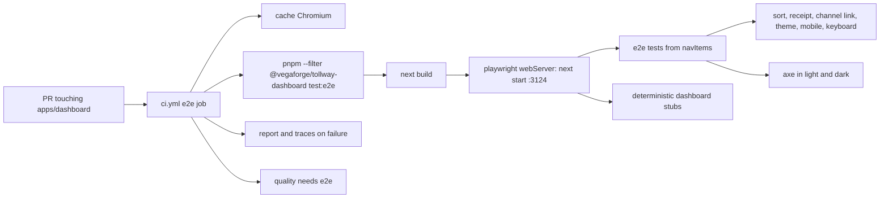

# ADR: Dashboard Playwright end-to-end and accessibility suite

- **Status:** Accepted 2026-11-19
- **Date:** 2026-11-19
- **Issue:** #240
- **Scope:** `apps/dashboard` test files, `apps/dashboard/package.json`, `pnpm-lock.yaml`, a new `apps/dashboard/playwright.config.ts`, small testability and keyboard fixes in `apps/dashboard/src`, `.github/workflows/ci.yml`, `docs/dashboard-data-contracts.md`, and a release note. No `packages/*` source changes, so no changeset. The dependency, config, and workflow paths are listed in `.github/security/sensitive-paths.txt` and need maintainer approval on the latest commit.

## Context

`apps/dashboard/vitest.config.ts:15-20` runs jsdom tests matched by `src/**/*.test.{ts,tsx}`. `apps/dashboard/package.json:8-13` has `dev`, `build`, `start`, `test`, and `typecheck`, with no browser-test script. jsdom cannot load the real Next.js route tree, observe hydration errors, measure focus order, or run an accessibility engine.

The dashboard currently has seven navigation entries in `apps/dashboard/src/components/shell/nav.ts:16-59`. Each page renders through `apps/dashboard/src/app/layout.tsx:30-39` into `DashboardShell`, which has a sidebar, topbar, and main content region but no skip link (`dashboard-shell.tsx:10-20`). `PageHeader` (`apps/dashboard/src/components/ui/page-header.tsx:4-22`) has no stable test hook. The receipts table uses a click handler on `<tr>` (`apps/dashboard/src/app/receipts/receipts-view.tsx:134-142`), so a keyboard user cannot select a row.

Theme behaviour comes from `next-themes` through `apps/dashboard/src/components/theme-provider.tsx:10-21` (`attribute="class"`, `defaultTheme="system"`, `enableSystem`). The toggle is `apps/dashboard/src/components/theme-toggle.tsx:11-55`. A browser suite can set the documented storage key before load, then verify the class and persistence after reload; the key must be checked against the installed `next-themes` source before use.

CI is defined in `.github/workflows/ci.yml`. The `quality` job at lines 155-175 aggregates `branch-flow`, `checks`, `tests`, and `build`, and treats any skipped or cancelled dependency as failure. A new e2e job must be added to that aggregate or it will not be a required gate.

As of 2026-11-19, #237 (typed service client) is open, so the dashboard still returns deterministic stubs. #239 (authentication) is open, so there is no login or logout flow to test yet. `npm view` on 2026-11-19 reported `@playwright/test` 1.65.1 and `@axe-core/playwright` 4.14.0. Those versions are evidence for this decision, not permission to code from memory; the implementation must verify APIs against the installed package source and current upstream docs.

## Decision

1. Add `@playwright/test` and `@axe-core/playwright` as dev dependencies of `@vegaforge/tollway-dashboard` with versions resolved by `pnpm add -D`. Do not add any other dependency. Confirm the installed APIs and the theme storage key before writing tests.
2. Add an `apps/dashboard` script `test:e2e` that builds the production app and then runs Playwright with `apps/dashboard/playwright.config.ts`. Leave `test` and `./scripts/preflight.sh` unchanged so the default gates stay browser-free.
3. `playwright.config.ts` sets `testDir: "./e2e"`, a fixed `baseURL` on `127.0.0.1`, and a `webServer` that runs `next start` against the built app. It defines three Chromium projects: light, dark, and mobile. Only Chromium is installed. Failures retain traces and screenshots; video stays off. Outside CI, an already running server may be reused.
4. Route coverage is generated from imported `navItems`, not from a second hard-coded list. For each href, a test follows the sidebar link, asserts the `PageHeader` test hook, and fails on any console error or page exception.
5. Add `data-testid="page-header"` to `PageHeader` and a skip link in `DashboardShell` that targets a real `id` on `<main>`. Add a real keyboard-operable control to each receipt row that preserves the existing mouse click and has a visible focus ring. Keep the failing keyboard test as the regression lock.
6. Flow tests cover agent sorting through the accessible `Spend` button, receipt selection showing `Signature valid`, the channel-receipt link landing on the channel row, theme toggle plus reload persistence, mobile topbar and navigation, and Tab or Enter operation with visible focus.
7. Run `@axe-core/playwright` on every route in both light and dark themes. Fail on serious and critical violations. Do not disable rules globally or add Semgrep or zizmor exceptions to make a finding disappear. Fix the component or narrow a test with a linked issue and maintainer agreement if a rule is genuinely wrong.
8. Use the existing deterministic stubs as the test data while #237 is open. If #237 lands first, switch the suite to `TOLLWAY_DASHBOARD_MODE=demo` and assert the demo badge; never call a live service, use a real API key, or invent a fallback.
9. Add an `e2e` job inside `.github/workflows/ci.yml` and add it to `quality.needs`. The job always reports success when no PR path under `apps/dashboard/**`, `pnpm-lock.yaml`, or the workflow itself changed, using `git diff` against the PR base with no third-party path-filter action. When paths match, it installs with `--frozen-lockfile`, caches `~/.cache/ms-playwright`, installs Chromium and its dependencies, runs `pnpm --filter @vegaforge/tollway-dashboard test:e2e`, and uploads the Playwright report and test results on failure. Actions remain pinned to full commit SHAs as in the existing workflow.
10. Document how to run and extend the suite in `docs/dashboard-data-contracts.md`, add a release note, and include in the PR description the output of one deliberately introduced regression that fails the suite before being reverted.

## Diagram



## Consequences

- The dashboard gains routing, hydration, focus, and contrast coverage that jsdom cannot provide.
- A real browser suite adds dependency and CI time, plus browser-cache management. Sensitive-path approval is a deliberate cost, not a gate to route around.
- Three small production changes are needed to make the app testable and keyboard accessible: a header test hook, a skip link, and a button in the receipt row.
- Stub data keeps the suite deterministic but does not validate the future service client, authentication, or payment behaviour. #239 will extend the suite with login and logout.
- E2E stays out of `pnpm test` and preflight, so local feedback remains fast; CI quality still requires it.
- Failing axe findings become bugs to fix. The suite does not hide them with rule disables.

## Alternatives considered

- **Stay with jsdom only.** Rejected: it cannot catch routing, hydration mismatch, focus order, or rendered contrast.
- **Put Playwright in the default `pnpm test` and preflight.** Rejected: browsers make every local and package test run slow, and preflight is meant to stay fast.
- **Create a separate workflow without adding it to `quality`.** Rejected: branch protection requires `quality`, so a failing e2e workflow could be ignored.
- **Use `dorny/paths-filter` for path detection.** Rejected: a third-party action adds supply-chain surface; plain `git diff` is enough.
- **Install all Playwright browsers.** Rejected: the suite only needs Chromium, including the mobile viewport project.
- **Disable axe rules that find violations.** Rejected: Directive 4 forbids masking; fix the app instead.
- **Skip or weaken the keyboard test and leave `<tr onClick>` as is.** Rejected: the issue explicitly expects that test to fail first and drive a fix.
- **Run against the live service.** Rejected: #237 has not landed; a test needing a real API key would be insecure and non-deterministic.
- **Add a changeset.** Rejected: the dashboard is a private app, and no publishable package source changes.

## Verification

Red first: add the e2e script and tests against the current app, then confirm failures for the missing config and script, the absent header hook, the absent skip link, and receipt rows that cannot be selected by keyboard. Demonstrate one deliberate regression, such as removing a PageHeader label, capture the failing Playwright output in the PR description, and revert it before review.

Green: add the two dev dependencies, the config, the small testability fixes, the receipt keyboard fix, the CI job, the docs section, and the release note. Then run:

```bash
pnpm --filter @vegaforge/tollway-dashboard test:e2e
pnpm --filter @vegaforge/tollway-dashboard test
./scripts/preflight.sh
```

Inspect the generated Playwright report after a failure to confirm traces and screenshots are attached. Confirm the CI job reports success on a PR that does not touch the dashboard and runs the suite on a PR that does. Confirm the security check sees the sensitive paths and waits for maintainer approval.
