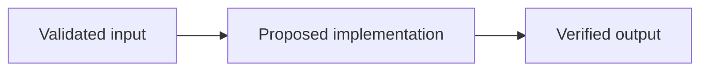

# ADR: Gate and adapter benchmark regression checks

- **Status:** Proposed, awaiting maintainer approval
- **Date:** 2026-11-19
- **Issue:** #248
- **Scope:** server and adapters benchmarks, scripts and CI; no unrelated dashboard UI

## Context

No benchmarks exist. Gate verification, signing, canonicalization, cache and replay paths need measurable performance. Shared CI runners make absolute baselines unreliable.

## Decision

1. Use a private benchmark workspace to avoid adapter cross-dependencies; pin Vitest 4.1.8, exclude *.bench.ts from vitest run.

2. Benchmark 402 challenge, fresh x402, replay, fresh mpp-charge, N concurrent identical requests and a mocked Redis cache/lock variant.

3. Exercise Express via ephemeral listen(0) and keep-alive HTTP, Fastify inject, Hono app.request, Next handler(Request); isolate canonicalJson, signing, verification, headers and nonce digest.

4. Use fixed payloads, pre-generated signer, mock facilitator, warmups and repeated samples; report median and p99.

5. Compare base and head on same runner. Propose 15% median regression threshold with 5% noise floor; repeat failures three times, require at least two failures. Thresholds require maintainer approval.

6. CI path-filtered for server/core/adapters, pinned actions, contents:read, no secrets; unit-test comparison and post job summary. Two unchanged-base green runs and artificial slowdown red run required.

## Diagram

## Consequences

ioredis-mock measures code paths, not real Redis; shared runner measurements are noisy. Implementation awaits explicit approval of both ADRs.

## Alternatives considered

Skipping architectural approval is prohibited. Mixing currencies, hiding regression failures, and bypassing SDK constraints are not acceptable substitutes for the specified design.

## Verification

Benchmark suite and comparison unit tests, two unchanged-base CI runs, deliberate regression CI failure, Biome, typecheck, full preflight and release note.
