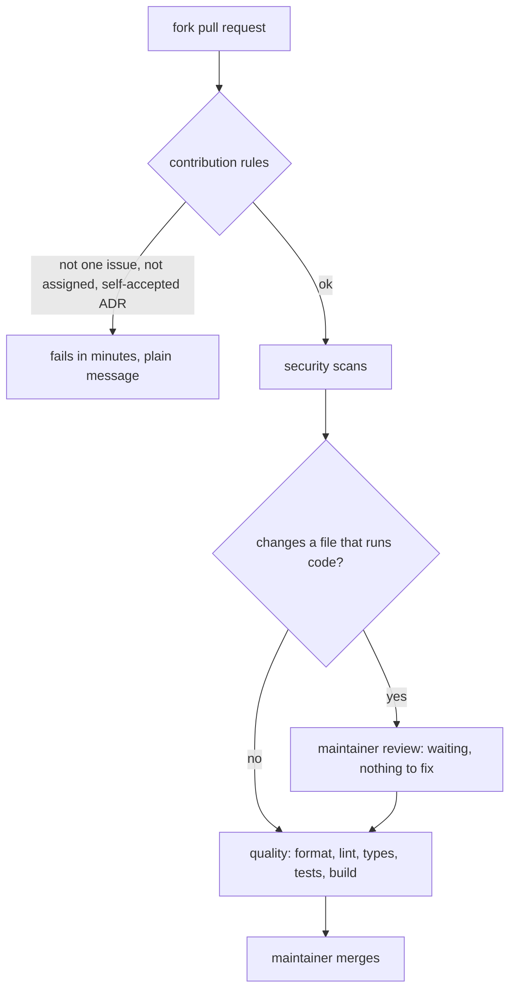

# ADR: Governance that fits an open-source project

- **Status:** Accepted 2026-11-19
- **Date:** 2026-11-19
- **Issue:** none (maintainer request)
- **Scope:** `AGENTS.md`, `CONTRIBUTING.md`, `.github/pull_request_template.md`, `.github/workflows/pr-security.yml` (also its speed and run cancellation), a new `scripts/security/check_contribution.py` with tests, the repository's Actions setting for fork pull requests, and the bodies of the open Wave issues. No package or app source changes.

## Context

`AGENTS.md` was written for coding agents working for the maintainer. Since
the Drips Wave opened, the same rules apply to strangers picking up 125
issues, and the first contribution (#275) showed where they do not fit:

1. **ADR approval as a gate before coding.** Directive 2 asks for an ADR
   pair and the maintainer's written approval before non-trivial work, and 96
   of the 125 Wave issues repeat it. A contributor cannot get that approval
   quickly, so the #275 author wrote eight ADRs and marked them "Accepted"
   themselves. The rule produced paperwork and a false approval, not review.
   Each Wave issue is already a design the maintainer wrote and published.
2. **Process failures surface late.** #275 closed four issues in one pull
   request. Nothing said so until a human looked; meanwhile ten CI jobs ran
   and failed for unrelated reasons.
3. **"Waiting for you" looks like "broken".** The `sensitive paths` job fails
   until the maintainer approves the latest commit. That is correct, but it
   shows as a red check next to real failures, and the message does not say
   the contributor has nothing to fix.
4. **CI waits for a click on every push.** The repository requires approval
   to run workflows for all external contributors
   (`approval_policy: all_external_contributors`), so every push to every fork
   pull request sits at "action required" until the maintainer approves it.
   Fork pull requests run with a read-only token and no secrets, and no
   workflow uses `pull_request_target`, so running a contributor's code in CI
   cannot reach the repository, its secrets or the maintainer's machine. The
   `security` check reads its scanner from the base branch, so a pull request
   cannot switch it off.
5. **The security check is slow and can cancel itself.** On #275 the
   `security` check took about 5 minutes, and 4 minutes 46 seconds of that
   was the `malware signatures` job installing ClamAV and downloading the
   full signature database; the scan itself took 7 seconds. CI's longest job
   took 54 seconds. A maintainer's review starts a second `security` run for
   the same commit, which cancels the first, and the cancelled run leaves a
   failing `security` check that blocks merging until it is re-run.
6. **Issues that contradict the gate.** #257 asked for tests that run the
   generated projects, which needs `child_process`, which the gate forbids.

## Decision

1. **Wave issues are approved designs.** A contributor working on an issue
   does not write an ADR pair or a plan. To change the approach the issue
   describes, they propose it in the issue thread first and wait for the
   maintainer to agree there. Any ADR a contributor adds stays
   `Proposed`; only the maintainer marks one `Accepted`. Directive 2 is
   unchanged for the maintainer's own architecture work and for coding agents.
   `AGENTS.md` gains a short "Contributors" section saying this, and
   CONTRIBUTING a "Before you push" box (run `./scripts/preflight.sh`, one
   issue per pull request, leave CI files alone unless the issue says so).
2. **A contribution-rules check runs first, from the base branch.** A new
   job in `pr-security.yml` (part of the required `security` check, using the
   base branch's copy of `scripts/security/check_contribution.py`) fails with
   a plain message when, for an author who is not a maintainer:
   - the body does not close exactly one issue;
   - the author is not assigned to that issue;
   - the pull request adds or changes an ADR whose status is `Accepted`.
   Maintainers and Dependabot are exempt, as they are for sensitive paths.
3. **Waiting for review says so.** The `sensitive paths` job is renamed
   `maintainer review` and its failure message starts with "Waiting for a
   maintainer to review" and states that the contributor has nothing to fix.
   It still blocks merging until the maintainer approves the latest commit.
4. **CI runs without a click for established accounts.** The repository's
   fork pull request approval policy becomes
   `first_time_contributors_new_to_github`: workflows run automatically except
   for accounts that are new to GitHub, the usual source of spam and malware
   pull requests. (Applied to Tollway on 2026-11-19 at the maintainer's
   direct request; Octroi and Evergreen follow.)
5. **The security check gets fast and stops cancelling itself.** The ClamAV
   signature database is cached with `actions/cache`, keyed by date, so a run
   restores it and `freshclam` only fetches the day's small update. ClamAV
   verifies its signature files on update, and a fork pull request cannot
   overwrite the base branch's cache. Runs for the same commit no longer
   cancel each other, so a review never leaves a cancelled, failing
   `security` behind.
6. **The maintainer approves and merges in one step.** Merging #276 showed
   that approving starts a passing security run, but the failure the push run
   recorded before the approval stays on the same commit and keeps the pull
   request blocked until that run is re-run. `scripts/approve-and-merge.sh
   <pr-number>` approves the head commit, re-runs that run's failed jobs, and
   turns on auto-merge. It never bypasses a check.
7. **The issues are swept.** The "write the ADR pair first" line is replaced
   with the rule in decision 1 in every open issue that has it, and any issue
   that asks for something the `security` check forbids is rewritten so the
   two agree.

## Diagram

## Consequences

- Contributors start coding from the issue. Design changes are agreed in
  public, in the thread, before the code.
- Wrong-shaped pull requests fail first and say why, instead of after ten
  unrelated jobs.
- The maintainer no longer clicks to start CI for most contributors. New
  GitHub accounts still need one approval.
- The check reads issue assignment through the API with the workflow's
  read-only token, which can read a public repository's issues.

## Alternatives considered

- **Keep ADR approval before coding for contributors.** It produced the
  self-approved ADRs in #275 and a bottleneck on the maintainer.
- **Require approval for first-time contributors only.** Safer against
  brand-new contributors, but every new Wave contributor would still wait for
  a click on their first pull request, which is most Wave pull requests.
- **Report maintainer review as a pending status instead of a failure.**
  Fork pull request workflows cannot write commit statuses (their token is
  read-only), so the clear message is the practical option.

## Verification

1. Unit tests for `check_contribution.py`, red first: zero issues, two issues,
   unassigned author, self-accepted ADR, and the passing cases (maintainer
   author, Dependabot, assigned contributor closing one issue).
2. `python3 -m unittest discover -s scripts/security` and
   `./scripts/preflight.sh` pass.
3. On the pull request itself: the `malware signatures` job takes about a
   minute on its second run (cache restored), and approving the pull request
   does not leave a cancelled, failing `security` check.
