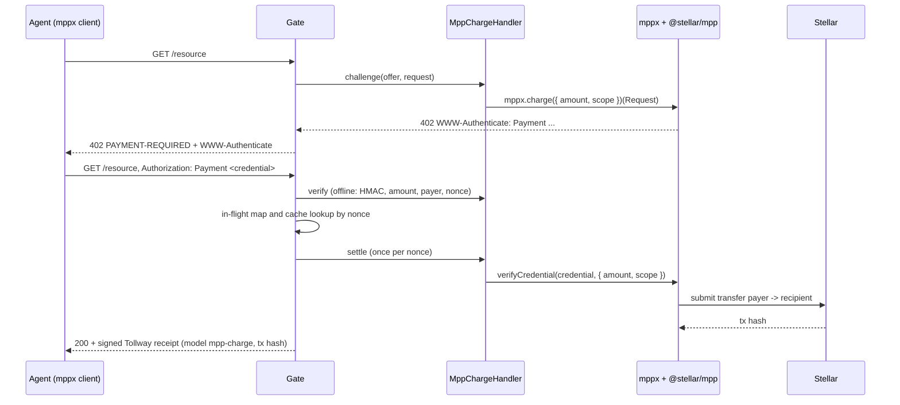

# ADR: Real Stellar settlement for MPP charge, MPP channels and the x402 client, and a bounded settlement cache

- **Status:** Proposed, awaiting maintainer approval
- **Date:** 2026-11-19
- **Issue:** #100, #101, #102, #103
- **Scope:** `@vegaforge/tollway-server` (MPP charge handler, gate's MPP path,
  in-memory cache), `@vegaforge/tollway-channels` (new Stellar adapter),
  `@vegaforge/tollway-client` (new x402 settler), `@vegaforge/tollway-core`
  (doc comment on `MppChargePayment.payload` only). The four framework
  adapters, the x402 path of the gate, the receipt format and the apps do
  not change.

## Context

- `createMppChargeHandler` threw `NotImplementedError`, and no package
  depended on `@stellar/mpp` (`packages/server/src/mpp-charge.ts`, before
  this change). The gate passed the x402 `PAYMENT-SIGNATURE` header to the
  MPP handler, but MPP clients send `Authorization: Payment ...` and expect
  `WWW-Authenticate: Payment ...` on the 402.
- `ChannelManager` is tested only against fakes of `MppChannelAdapter`
  (`packages/channels/src/adapter.ts`).
- `createClient` delegates protocol work to an injected `ClientSettler`, and
  no real settler existed (`packages/client/src/index.ts`).
- `createInMemorySettlementCache` only deleted an entry when that exact key
  was read after expiry, so the `Map` grew for the life of the process
  (`packages/server/src/cache.ts`).
- Installed upstream versions, read from their type definitions:
  `@stellar/mpp` 0.7.1 (the latest; peer `mppx` `^0.6.29`, peer
  `@stellar/stellar-sdk` `^15.1.0`), `mppx` 0.8.19, `@x402/core` and
  `@x402/stellar` 2.16.0.
- Every `mppx` below 0.8.2 carries GHSA-vc9j-9wph-qghj and
  GHSA-727h-3vm5-qwq6 (gas draining in its EVM code). The `security` check
  fails a pull request that adds a known vulnerability, and no `@stellar/mpp`
  release accepts `mppx` 0.8 yet. `@stellar/stellar-sdk` 15.1.0 pins axios
  1.15.0, which has advisories the repository's axios 1.18.0 does not.
  - `mppx/dist/server/Mppx.d.ts`: `Mppx.create({ methods, secretKey, realm })`,
    `mppx.charge(options)(request)` returns `{ status: 402, challenge }` or
    `{ status: 200, withReceipt }`, `verifyCredential(credential, { request,
    scope })` returns a `Receipt` whose `reference` is the transaction hash.
  - `@stellar/mpp/dist/charge/server/Charge.d.ts`: `charge({ recipient,
    currency, network, decimals, store, feePayer, rpcUrl })`; `store` is
    required and must have an atomic `update()`.
  - `@stellar/mpp/dist/shared/units.js`: `toBaseUnits(amount, 0)` returns
    the integer unchanged.
  - `@stellar/mpp/dist/channel/server/Channel.d.ts`: `close({ channel,
    amount: bigint, signature: Uint8Array, feePayer, network })` resolves the
    transaction hash. `State.d.ts`: `getChannelState({ channel, network })`.
    There is no deploy or open function.
  - `@stellar/mpp/dist/channel/client/Channel.js`: the client method signs
    the bytes returned by simulating `prepare_commitment(amount)` with the
    commitment key, after `assertCommitmentBinds`, and never submits.
  - `@x402/stellar/dist/esm/exact/client`: `ExactStellarScheme(signer,
    rpcConfig?)`; `@x402/core/client`: `x402Client.register(network,
    scheme).createPaymentPayload(paymentRequired)`; `@x402/core/http`:
    `decodePaymentRequiredHeader`, `encodePaymentSignatureHeader`.

## Decision

0. Pin `mppx` 0.8.19 (latest 0.8.x) outside `@stellar/mpp`'s declared peer
   range, and override axios below 1.16.0 to the 1.18.0 already in the
   lockfile, so the pull request adds no advisory. The `mppx` APIs Tollway
   and `@stellar/mpp` call were exercised offline against the real packages
   (challenge, HMAC, route and scope binding, payload validation, channel
   `createCredential` up to the RPC simulation). Return to the declared range
   when `@stellar/mpp` widens it.
1. `createMppChargeHandler(options)` builds one `Mppx` instance with
   `stellar.charge({ recipient, currency, network, decimals: 0, store,
   feePayer, rpcUrl })`. `decimals: 0` keeps amounts integer base units end
   to end.
2. `MppChargeHandler` gains an optional `challenge({ offer, request })`. The
   gate calls it on a 402 when the route accepts `mpp-charge` and merges the
   headers `mppx` produced (`WWW-Authenticate`, `Cache-Control`) next to
   `PAYMENT-REQUIRED`. Every challenge is scoped to `offer.resource`.
3. The gate reads the MPP credential from the `Payment` scheme of the
   `Authorization` header, only on routes that accept `mpp-charge`. A
   credential selects the MPP path directly. A `PAYMENT-SIGNATURE` routed to
   `mpp-charge` is rejected with 400. The x402 path is unchanged.
4. `verify` is offline: decode the credential, check method and intent,
   check the HMAC with `Challenge.verify`, check the amount and the handler's
   recipient, currency and network against the offer, and read the payer
   from the `did:pkh` source. The nonce is the SHA-256 of the credential, so
   the gate's in-flight map and settlement cache dedupe retries before any
   on-chain work.
5. `settle` calls `mppx.verifyCredential(credential, { request: { amount },
   scope: resource })`. `mppx` and `@stellar/mpp` errors become a `rejected`
   outcome with the library's message; anything else becomes a
   `TollwayError` with code `payment-failed`. Secrets never enter a reason.
6. `createStellarMppChannelAdapter(options)` is bound to one deployed,
   funded contract. It does not deploy. `openChannel` checks the contract
   with `getChannelState` (recipient, token, not closing, balance covers the
   deposit) and reports the configured deploy transaction hash.
   `signCommitment` uses the `@stellar/mpp` client method's
   `createCredential` with a locally built challenge, so signing reuses the
   SDK's own simulate, bind-check and sign path and submits nothing.
   `closeChannel` calls `close` once. Configuration errors throw at
   construction. #38 has not merged, so there are no recovery methods to
   implement; closing a channel with no commitments points at #38.
7. `createX402Settler({ signer, network, fetch?, rpcUrl?, method? })` speaks
   x402 V2 through `@x402/core/http`, signs with `ExactStellarScheme`, and
   reads the receipt from `TOLLWAY-RECEIPT`. It refuses a 402 whose amount,
   payee or (contract) asset differs from the offer the policy approved.
8. `createInMemorySettlementCache(ttlMs, { maxEntries = 10000, now })`
   sweeps expired entries from the oldest end on `set` and evicts the oldest
   entry when full. An overwrite moves the key to the newest end. No timer.

## Diagram

## Consequences

- A route can serve x402 and MPP charge at once; switching is configuration.
- `mppx` 0.8.19 is outside `@stellar/mpp` 0.7.1's peer range, so pnpm warns
  about the peer; the opt-in testnet tests are the check that the pair works
  on chain.
- `@vegaforge/tollway-server` and `@vegaforge/tollway-channels` take
  `@stellar/mpp` and `mppx` as runtime dependencies, and through peers
  `@stellar/stellar-sdk` 15 and `viem`. The x402 packages still use
  stellar-sdk 14, so two majors are installed side by side.
- For `mpp-charge`, the paywall `asset` must be the SEP-41 contract address
  the handler charges, or the handler refuses the offer. This keeps the
  receipt's `asset` truthful.
- `mppx` replay protection (its `store`) and Tollway's settlement cache both
  run. They protect different things: `mppx` refuses a consumed challenge or
  transaction, Tollway avoids reaching `/settle` twice for one credential.
- The channel adapter serves one contract per instance; a manager that opens
  many channels needs one adapter per contract or a later factory.
- The client settler pays services that already speak x402 V2; the gate does
  so after #43.

## Alternatives considered

- `mppx` 0.6.31, inside the peer range. Rejected: it adds two advisories,
  which fails the `security` check.
- Calling `mppx.charge(...)(request)` for the credential path too. It
  verifies and settles in one call, which skips the gate's dedupe and cache
  lookup before settlement. Rejected.
- Converting base units to decimal strings for `@stellar/mpp`. Needs string
  arithmetic both ways for no gain over `decimals: 0`. Rejected.
- Reimplementing `prepare_commitment` simulation and signing in the channel
  adapter. Duplicates SDK code, including its binding check. Rejected in
  favour of the client method's `createCredential`.
- Deploying the channel contract from `openChannel`. `@stellar/mpp` 0.7 has
  no deploy API, and inventing one breaks the no-invented-surface rule.
- A background timer to sweep the cache. Keeps processes alive and is not
  needed when every write sweeps.

## Verification

- Red first: `cache.test.ts` (size cap, sweep on `set`, expired `get` with an
  injected clock) failed before the change for the missing behaviour.
- Unit tests with the SDKs stubbed at the module boundary:
  `mpp-charge.test.ts` (challenge, verify success and each failure, settle
  success, `mppx` and `@stellar/mpp` failures, transport failure, retry and
  concurrent dedupe through the gate), `gate.test.ts` (Authorization
  credential, challenge headers, x402-only routes unchanged),
  `stellar-adapter.test.ts`, `x402-settler.test.ts`.
- Opt-in testnet tests: `mpp-charge.integration.test.ts`
  (`TOLLWAY_MPP_CHARGE_INTEGRATION=true`) and
  `stellar-adapter.integration.test.ts` (`TOLLWAY_CHANNEL_INTEGRATION=true`).
- `./scripts/preflight.sh`, and
  `MOCK_MODE=true pnpm --filter @vegaforge/tollway-demo start`.
