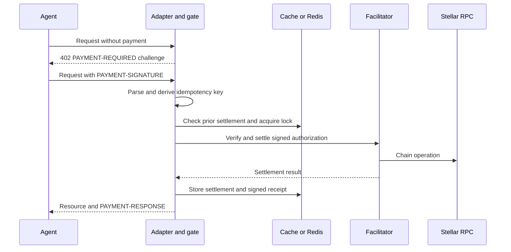
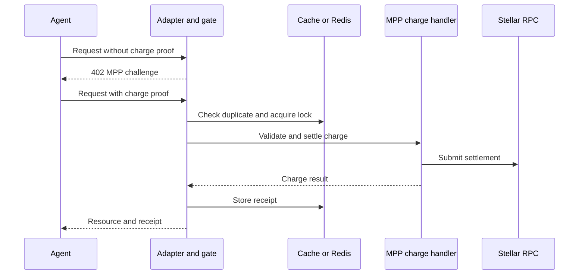

# Tollway threat model

This document describes the current payment boundary and the evidence for its defenses. Review it every six months and whenever payment, receipt, cache, adapter, channel, policy, or reconciliation behavior changes. Changes to the payment path must update it in the same pull request.

## Assets

| Asset | Why it matters | Main code or boundary |
| --- | --- | --- |
| Payer funds | Duplicate or unauthorized settlement causes direct loss. | `packages/server/src/gate.ts`, facilitator |
| Service revenue | Incorrect offers or receipts can deny or misattribute payment. | `packages/server/src/gate.ts`, adapters |
| Receipt signing keys | A compromised key can make forged receipts appear authentic. | `packages/core/src/receipt/signer.ts` |
| Facilitator API keys | These authorize requests to an external settlement service. | `packages/server/src/facilitator.ts`, operator environment |
| Policy state | Incorrect budgets or limits can allow unwanted spending. | `packages/core/src/policy.ts`, caller storage |
| Settlement and lock state | Lost or conflicting state can permit replay or reconciliation drift. | `packages/server/src/cache.ts`, `packages/reconcile` |
| Channel commitments | A commitment represents an enforceable cumulative amount. | `packages/channels`, MPP contract and SDK |

## Trust boundaries

- **Agent to gate:** payment and MPP headers are attacker-controlled. Framework adapters translate request headers in `packages/adapter-*`.
- **Gate to facilitator:** `packages/server/src/facilitator.ts` calls external verification and settlement APIs. Tollway cannot make a facilitator honest.
- **Facilitator to Stellar RPC:** the facilitator and RPC determine chain observations, outside Tollway's process and operational control.
- **Gate to Redis or cache:** shared state crosses process boundaries. `packages/server/src/cache.ts` coordinates settlement records and locks.
- **MPP channel contract:** contract state and signed commitments govern channel value. Tollway does not custody channel funds.
- **Dashboard to service configuration:** dashboard users and deployment operators can change policy and key configuration. Hosting authentication and authorization protect this boundary.
- **Service route to gate:** adapters preserve gate outcomes and headers; application code controls which resources are protected.

## Attacker capabilities

An unauthenticated caller can send arbitrary methods, paths, header values, repeated headers, malformed encodings, and previously used payment material. A caller may race identical requests across threads or processes. A compromised service process can access its configured signing and facilitator credentials. A malicious or faulty facilitator, Redis operator, RPC provider, dashboard user, or MPP counterparty can return incorrect data or deny service. Network attackers are assumed unable to defeat TLS but may exploit inconsistent parsing at intermediaries.

## Data flows

### x402 request payment



### MPP charge



### MPP channel

```mermaid
sequenceDiagram
  participant A as Agent
  participant G as Service gate
  participant M as MPP SDK
  participant C as Soroban channel contract
  A->>G: Request with signed cumulative commitment
  G->>M: Validate channel context and commitment
  M->>C: Read channel state as needed
  M-->>G: Validated commitment
  G-->>A: Resource and normalized receipt
  Note over A,C: Funds remain in the contract; close settles cumulative value.
```

## Abuse paths and mitigations

Likelihood and impact are qualitative. Defended rows name an executable test. Open cases link their owning issue and do not disclose vulnerability details.

| ID | Abuse path | Likelihood | Impact | Mitigation and evidence | Status |
| --- | --- | --- | --- | --- | --- |
| TM-01 | Replay a settled payment to cause a second charge | Medium | High | Idempotency lookup and lock; `packages/server/src/gate.test.ts`, `describe("TM-01")` | defended |
| TM-02 | Reuse payment against a different offer | Medium | High | Receipt-to-offer binding; `packages/server/src/gate.test.ts`, `describe("TM-02")` | defended |
| TM-03 | Race duplicate settlement within one process | Medium | High | In-flight map and cache lock; `packages/server/src/gate.test.ts`, `describe("TM-03")` | defended |
| TM-04 | Race duplicate settlement across processes sharing Redis | Low | High | Shared lock; `packages/server/src/gate.test.ts`, `describe("TM-04")` | defended |
| TM-05 | Change a signed receipt field | Medium | High | Strict schema and signature verification; `packages/core/src/receipt/receipt.test.ts`, `describe("TM-05")` | defended |
| TM-06 | Present a receipt signed by an untrusted key | Low | High | Verifier trust set; `packages/core/src/receipt/receipt.test.ts`, `describe("TM-06")` | defended |
| TM-07 | Submit malformed or oversized payment headers | Medium | Medium | Malformed input rejection is covered. Size bound is tracked by #256 | partially defended |
| TM-08 | Send repeated payment headers parsed differently by intermediaries | Medium | High | Open; tracked by #256 | open |
| TM-09 | Bypass policy by changing caller-controlled policy state | Low | High | Integrator must protect policy storage; deployment controls are outside the library | partially defended |
| TM-10 | Reconciliation accepts incorrect external settlement data | Low | High | Validate upstream data and compare chain state; facilitator/RPC correctness is out of scope | partially defended |

Open and partially defended paths do not have skipped or expected-to-fail tests. If a new security defect is discovered, report it privately via [SECURITY.md](../SECURITY.md); keep its public description non-sensitive and link the owning issue.

## Boundaries Tollway does not cover

Tollway is non-custodial: x402 settles to the configured payee and MPP channel funds remain in the contract. Tollway does not guarantee facilitator correctness, wallet or signer security, Stellar RPC correctness, dashboard identity security, or upstream availability. Operators must secure credentials, restrict configuration access, and monitor facilitator and chain dependencies. See [What Tollway is not](design.md#what-tollway-is-not).
